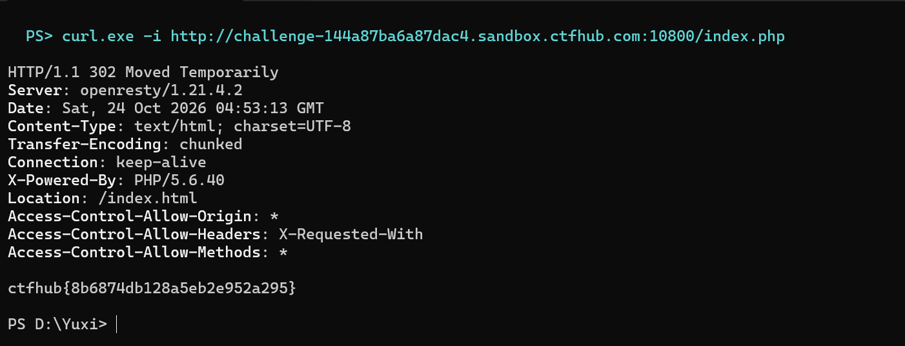

# WP：302 跳转

> **CTFHub 路径**：技能树 → Web → Web 前置技能 → HTTP 协议 → 302 跳转
> **任务**：观察 302 重定向，按题目提示找到 flag。
> **提示**：浏览器通常会自动跟随 302，所以你可能只看到最终页面。打开 DevTools 的 Network 面板（勾选 Preserve log）或 Burp，查看原始响应中的 `302` 状态码和 `Location` 响应头。
> **截图要求**：能看到 302 状态码和/或 `Location` 响应头，以及最终的 flag。只截最终页面、没有 302 证据的截图不合格。

---

## 题目信息

| 项目 | 内容 |
| --- | --- |
| 环境地址 | http://challenge-144a87ba6a87dac4.sandbox.ctfhub.com:10800 |
| Flag | ctfhub{8b6874db128a5eb2e952a295} |

## 解题过程

在浏览器里打开靶场地址，地址栏一闪就变成了 `index.html`，页面只有一句 `No Flag here!` 和一个 `Give me Flag` 链接；点这个链接又跳回 `index.php`，再跳回 `index.html`，来回转圈，页面上永远看不见 flag。
这说明 flag 不在"跳过去的那个页面"上，而是在"跳转本身"里。我在终端里用 `curl -i` 直接请求 `index.php`（curl 默认不跟随跳转），响应头是 `302 Moved Temporarily` 加 `Location: /index.html`，而响应体的最后一行就是 flag —— 浏览器自动跟着 `Location` 走了，把这段响应体丢掉了，所以页面里看不到。
确认之后我又在 Burp 里重放了一次：关掉 `Follow redirect` 之后，Repeater 的响应面板里也能看到这行 flag。把 flag 提交到题目页面，平台提示正确。

## 关键请求/响应

```http
GET /index.php HTTP/1.1
Host: challenge-144a87ba6a87dac4.sandbox.ctfhub.com:10800
User-Agent: curl/8.5.0
Accept: */*

HTTP/1.1 302 Moved Temporarily
Server: openresty/1.21.4.2
Date: Sat, 24 Oct 2026 04:53:13 GMT
Content-Type: text/html; charset=UTF-8
Transfer-Encoding: chunked
Connection: keep-alive
X-Powered-By: PHP/5.6.40
Location: /index.html

ctfhub{8b6874db128a5eb2e952a295}
```

```http
（浏览器自动跟随 Location 后发出的第二个请求，这个页面反而没有 flag）

GET /index.html HTTP/1.1
Host: challenge-144a87ba6a87dac4.sandbox.ctfhub.com:10800

HTTP/1.1 200 OK
Content-Type: text/html; charset=utf-8

<h1>No Flag here!</h1>
<a href="index.php">Give me Flag</a>
```

## 原理与复盘

302 是临时重定向：状态行 `302 Moved Temporarily` 加响应头 `Location: /index.html` 告诉浏览器"去这个地址拿内容"，浏览器会自动再发一次请求，并且通常把 302 这条响应的响应体丢掉。flag 恰好就藏在这段被丢掉的响应体里，所以点链接、看页面都没用。
200 和 302 的差别不在页面上，而在状态行和响应头里：不打开 Network 面板、不用 Burp 或 curl 关掉自动跳转，就等于没看见这次跳转。这题让我记住，重定向本身也能携带信息，看流量要看原始报文而不是渲染后的页面。

---

## 截图



> 可以在这份 WP 中另加过程截图；检查时只看指定图片，额外图片不检查。
