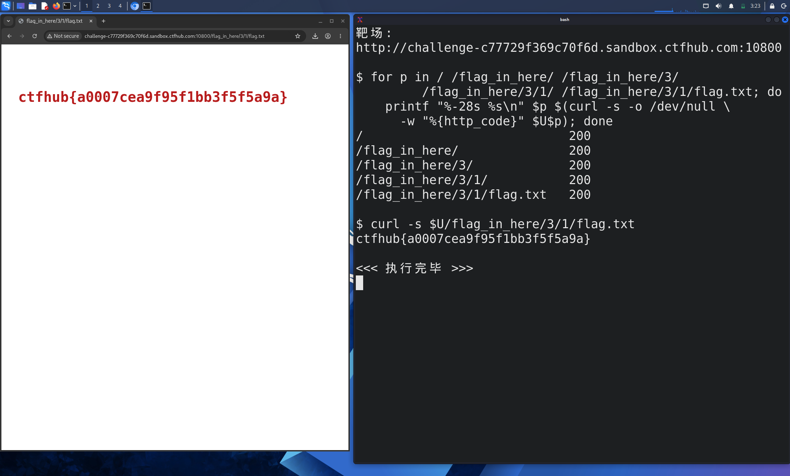

# WP：目录遍历

> **CTFHub 路径**：技能树 → Web → 信息泄露 → 目录遍历
> **任务**：按题目页面提示找到 flag。
> **提示**：注意页面给出的路径和 URL；目录列表本身就是一种信息泄露。只在题目环境内点击和访问，不要使用扫描器扫描其他地址。
> **截图要求**：能看到题目环境地址（或题目名称）、你访问的目录/路径，以及最终的 flag。

---

## 题目信息

| 项目 | 内容 |
| --- | --- |
| 环境地址 | http://challenge-c77729f369c70f6d.sandbox.ctfhub.com:10800 |
| Flag | ctfhub{a0007cea9f95f1bb3f5f5a9a} |

## 解题过程

开启题目后，浏览器访问靶场根目录，页面直接返回一个目录索引（Apache 的 "Index of /" 风格），列出了 `flag_in_here/` 等若干条目，说明服务器没有关闭目录浏览。我点进 `flag_in_here/`，里面又是一层编号目录 `1/`、`2/`、`3/`……，每一层都还能继续往下点，说明这是一棵故意做深的目录树，只能逐层看下去。为了更快，我在 Kali 终端里用 `curl` 配合一段循环脚本，从根目录开始把每一层的 `href` 抓出来、只跟入以 `/` 结尾的目录，一直往下走到遇到名字带 `flag` 的文件为止。脚本遍历了 18 个目录后，在 `/flag_in_here/3/1/flag.txt` 停下，用 `curl` 取回该文件，内容就是 flag。最后访问这个路径时浏览器地址栏显示的正是 `/flag_in_here/3/1/flag.txt`，与截图一致。

## 关键请求/响应

```http
GET /flag_in_here/3/1/flag.txt HTTP/1.1
Host: challenge-c77729f369c70f6d.sandbox.ctfhub.com:10800
User-Agent: curl/8.20.0
Accept: */*

HTTP/1.1 200 OK
Server: openresty/1.21.4.2
Content-Type: text/plain
Content-Length: 33

ctfhub{a0007cea9f95f1bb3f5f5a9a}
```

逐层探测时各目录返回的状态码（截图右侧终端）：

```text
/                              200
/flag_in_here/                 200
/flag_in_here/3/               200
/flag_in_here/3/1/             200
/flag_in_here/3/1/flag.txt     200
```

## 原理与复盘

这道题泄露点在 **URL 路径 + 响应体**：服务器把目录内容当成页面渲染出来，攻击者只要知道（或猜到）路径就能一层层走下去，根本不需要"入侵"。目录列表本身只是一个展示功能，但它把目录结构、文件名、备份文件和配置文件全部告诉了访问者，等于把站点的"地图"送出去，所以生产环境一般都要求 `Options -Indexes`。防护上除了关掉目录浏览，还要避免把 flag、备份、源码放在 Web 根目录下，并给敏感路径加上鉴权。

---

## 截图



> 可以在这份 WP 中另加过程截图；检查时只看指定图片，额外图片不检查。
