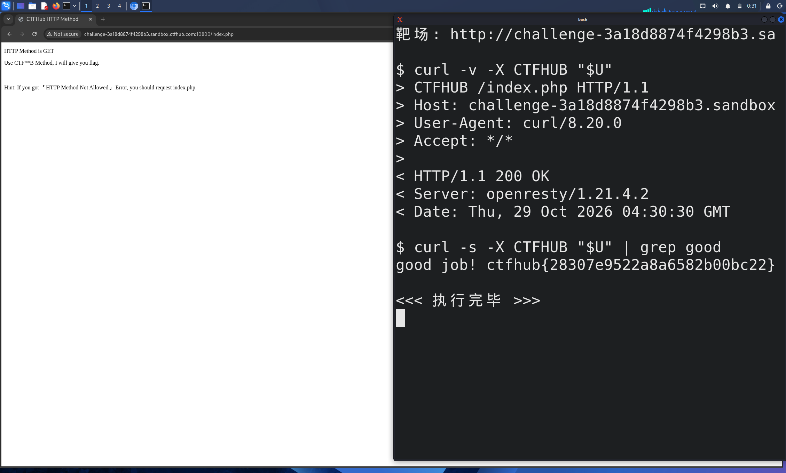

# WP：请求方式

> **CTFHub 路径**：技能树 → Web → Web 前置技能 → HTTP 协议 → 请求方式
> **任务**：按题目要求使用指定的 HTTP 方法访问目标，拿到 flag。
> **提示**：浏览器地址栏默认发送 GET 请求。用 Burp Repeater 修改请求行中的方法，或者用 `curl -X` 复现。
> **截图要求**：优先使用 Burp Repeater，截图中要能看到修改后的请求行（方法 + 路径）和响应中的 flag；如果 Burp 无法启动，可以用 `curl -X` 的方法修改截图代替，并在 WP 中说明原因。只有浏览器普通 GET 访问不算完成。

---

## 题目信息

| 项目 | 内容 |
| --- | --- |
| 环境地址 | http://challenge-3a18d8874f4298b3.sandbox.ctfhub.com:10800/index.php |
| Flag | ctfhub{28307e9522a8a6582b00bc22} |

## 解题过程

用浏览器直接打开靶场，页面只有三行字：`HTTP Method is GET`、`Use CTF**B Method, I will give you flag.`，以及提示 `If you got 'HTTP Method Not Allowed' Error, you should request index.php.`。第一行说明服务器按请求行里的方法来判断，第二行把 `CTF**B` 暴露得很明显——把 `**` 补成 `HU` 就是 `CTFHUB`，也就是说它接受一个自定义方法名。由于浏览器地址栏只会发 GET，我没法用地址栏改方法，于是按提示在 Kali 终端里用 `curl -X CTFHUB` 直接指定方法，并把请求发到提示要求的 `index.php`。用 `curl -v` 回看时能看到请求行确实变成了 `CTFHUB /index.php HTTP/1.1`，服务器返回 `200 OK` 而不是 `405 Method Not Allowed`，响应体是 `good job! ctfhub{...}`。为了把 flag 单独挑出来，我又加了一次 `grep good`，输出同样是这一行。本题我用的是模板允许的 `curl -X` 方式而不是 Burp Repeater：`-X` 可以直接把请求行第一个 token 换成任意方法名，再用 `-v` 就能把发出去的请求行原样回显，比在 Repeater 里手改更省事。

## 关键请求/响应

```http
CTFHUB /index.php HTTP/1.1
Host: challenge-3a18d8874f4298b3.sandbox.ctfhub.com:10800
User-Agent: curl/8.20.0
Accept: */*

HTTP/1.1 200 OK
Server: openresty/1.21.4.2
Date: Thu, 29 Oct 2026 04:30:30 GMT
Content-Type: text/html; charset=utf-8

good job! ctfhub{28307e9522a8a6582b00bc22}
```

对应的终端命令与输出：

```text
$ curl -v -X CTFHUB "$U"
> CTFHUB /index.php HTTP/1.1
> Host: challenge-3a18d8874f4298b3.sandbox.ctfhub.com:10800
> User-Agent: curl/8.20.0
> Accept: */*
< HTTP/1.1 200 OK
< Server: openresty/1.21.4.2

$ curl -s -X CTFHUB "$U" | grep good
good job! ctfhub{28307e9522a8a6582b00bc22}
```

## 原理与复盘

请求行由三部分组成：**方法 + 请求目标（路径）+ HTTP 版本**，例如 `CTFHUB /index.php HTTP/1.1`，方法永远在最前面，这就是本题唯一需要改的位置——改请求头、改参数都没用，因为服务器判断的是第一个 token。HTTP 方法本身是开放集合，GET/POST 只是最常用的两个，服务端完全可以用自定义方法名，甚至可以借此做一点"反爬"或彩蛋；反过来说，如果服务端的权限判断挂在"只处理 GET/POST"的分支上，换一个方法就可能绕过检查。

---

## 截图



> 可以在这份 WP 中另加过程截图；检查时只看指定图片，额外图片不检查。
