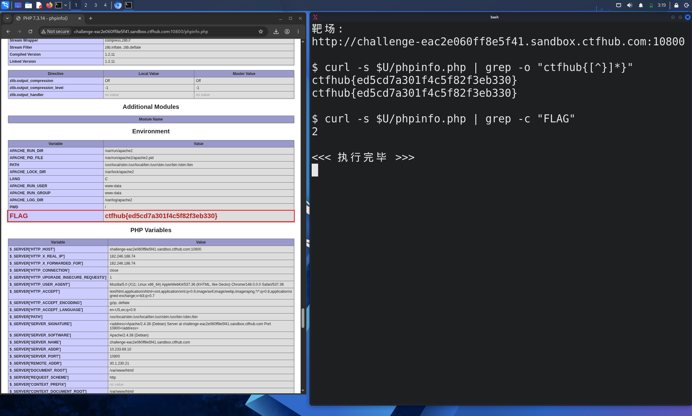

# WP：PHPINFO

> **CTFHub 路径**：技能树 → Web → 信息泄露 → PHPINFO
> **任务**：在 phpinfo 页面中找到 flag，并观察它泄露了哪些信息。
> **提示**：phpinfo 会输出大量 PHP 和服务器配置。用浏览器的查找功能搜索关键字，同时留意页面暴露的路径、版本、环境变量等信息。
> **截图要求**：能看到 phpinfo 页面、你搜索/定位到的 flag，以及至少一处敏感信息。

---

## 题目信息

| 项目 | 内容 |
| --- | --- |
| 环境地址 | http://challenge-eac2e060ff8e5f41.sandbox.ctfhub.com:10800/phpinfo.php |
| Flag | ctfhub{ed5cd7a301f4c5f82f3eb330} |

## 解题过程

开启题目后访问靶场根目录得到的是一个 `phpinfo.php`，页面是典型的 phpinfo 输出：先是 PHP 版本、System、Build Date 等基础信息，接着是 Configuration、Modules，再往下才是 Environment 和 PHP Variables 两大张长表。我先在浏览器里用 `Ctrl + F` 搜 `flag`，页面里并没有直接命中一个"题目提示"式的关键字，于是我改成在 Kali 终端里用 `curl` 把页面抓下来再检索：`curl -s $U/phpinfo.php | grep -o 'ctfhub{[^}]*}'` 直接命中两次，说明这个字符串出现在两个地方。回到浏览器往下滚到 Environment 表，果然在 `PWD` 下面看到一行 `FLAG`，值是 `ctfhub{ed5cd7a301f4c5f82f3eb330}`；继续往下到 PHP Variables 表，`$_ENV['FLAG']` 里又是同一个值（`grep -c FLAG` 统计为 2 也是这个原因）。除了 flag，这页还泄露了 `SERVER_SOFTWARE`、`DOCUMENT_ROOT=/var/www/html`、`SERVER_ADDR`、完整的 `Apache/2.4.38 (Debian)` 版本与 PHP 7.3.14 版本等配置。

## 关键请求/响应

```http
GET /phpinfo.php HTTP/1.1
Host: challenge-eac2e060ff8e5f41.sandbox.ctfhub.com:10800
User-Agent: curl/8.20.0
Accept: */*

HTTP/1.1 200 OK
Server: openresty/1.21.4.2
Content-Type: text/html; charset=UTF-8
```

页面中命中 flag 的片段（Environment 表）：

```html
<tr><td class="e">APACHE_LOG_DIR </td><td class="v">/var/log/apache2 </td></tr>
<tr><td class="e">PWD </td><td class="v">/ </td></tr>
<tr><td class="e">FLAG </td><td class="v">ctfhub{ed5cd7a301f4c5f82f3eb330} </td></tr>
```

终端检索结果：

```text
$ curl -s $U/phpinfo.php | grep -o "ctfhub{[^}]*}"
ctfhub{ed5cd7a301f4c5f82f3eb330}
ctfhub{ed5cd7a301f4c5f82f3eb330}
$ curl -s $U/phpinfo.php | grep -c "FLAG"
2
```

## 原理与复盘

phpinfo 是 PHP 自带的调试页面，它把 **响应体**（页面正文）变成了"配置清单"：版本号、编译参数、扩展、`DOCUMENT_ROOT` 之类的绝对路径、环境变量、甚至数据库连接串都可能原样打印出来。对攻击者来说这是极高价值的侦察材料——知道 PHP 和框架版本就能对着 CVE 找匹配的漏洞，知道绝对路径就能为任意文件读取、日志写入等利用做准备。所以生产环境绝对不能把 `phpinfo()` 留在可访问的路径上，测试完成就要删除。

---

## 截图



> 可以在这份 WP 中另加过程截图；检查时只看指定图片，额外图片不检查。
