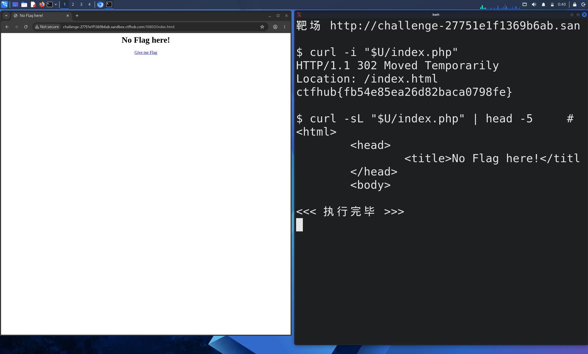

# WP：302 跳转

> **CTFHub 路径**：技能树 → Web → Web 前置技能 → HTTP 协议 → 302 跳转
> **任务**：观察 302 重定向，按题目提示找到 flag。
> **提示**：浏览器通常会自动跟随 302，所以你可能只看到最终页面。打开 DevTools 的 Network 面板（勾选 Preserve log）或 Burp，查看原始响应中的 `302` 状态码和 `Location` 响应头。
> **截图要求**：能看到 302 状态码和/或 `Location` 响应头，以及最终的 flag。只截最终页面、没有 302 证据的截图不合格。

---

## 题目信息

| 项目 | 内容 |
| --- | --- |
| 环境地址 | http://challenge-27751e1f1369b6ab.sandbox.ctfhub.com:10800/index.php |
| Flag | ctfhub{fb54e85ea26d82baca0798fe} |

## 解题过程

浏览器打开靶场后，地址栏从 `/index.php` 自己变成了 `/index.html`，页面上只有一句 `No Flag here!` 和一个 `Give me flag` 链接，点进去也没有 flag——说明我看到的已经是跳转后的"终点页"，真正有价值的东西在第一次响应里。因为浏览器会无条件跟随 3xx，我改用 Kali 终端里的 `curl -i` 直接发一次请求并把响应头一起打印出来，这时就能看到第一跳是 `HTTP/1.1 302 Moved Temporarily`，并带有 `Location: /index.html`；而这次 302 的响应体里直接就是 flag，压根不需要跟随到 `index.html`。为了确认"跟随跳转反而拿不到 flag"，我又用 `curl -sL -i` 让 curl 自动跟随，结果拿到的是 `No Flag here!` 那个 HTML 页面。所以结论是：关掉自动跟随、只看第一跳的 302 响应，flag 就在响应体里。

## 关键请求/响应

不跟随跳转，直接看第一跳（截图右侧终端）：

```http
GET /index.php HTTP/1.1
Host: challenge-27751e1f1369b6ab.sandbox.ctfhub.com:10800
User-Agent: curl/8.20.0

HTTP/1.1 302 Moved Temporarily
Location: /index.html
Content-Type: text/html; charset=utf-8

ctfhub{fb54e85ea26d82baca0798fe}
```

用 `-L` 跟随跳转后拿到的是 200 的终点页：

```http
GET /index.html HTTP/1.1
Host: challenge-27751e1f1369b6ab.sandbox.ctfhub.com:10800

HTTP/1.1 200 OK
Content-Type: text/html

<html>
    <head>
        <title>No Flag here!</title>
    </head>
    <body>...
```

## 原理与复盘

302 和 200 的区别在**状态行**：`200` 表示"这就是你要的内容"，浏览器直接把响应体渲染出来；`302` 表示"内容不在这里，去 `Location` 指的地方取"，浏览器会自己再发一次请求，于是 DevTools 里默认只看到最后一跳，中间的 302 被"藏"起来了（Network 面板要勾 Preserve log 才留得住）。这道题正好利用了大家的这个习惯：真正的 flag 藏在 302 那一跳的响应体里，只要不跟随跳转就能看到。实战里遇到"点了链接却拿不到东西"的情况，先把重定向链拆开看每一跳，往往能发现跳转前后响应体、Cookie 或鉴权状态的变化。

---

## 截图



> 可以在这份 WP 中另加过程截图；检查时只看指定图片，额外图片不检查。
