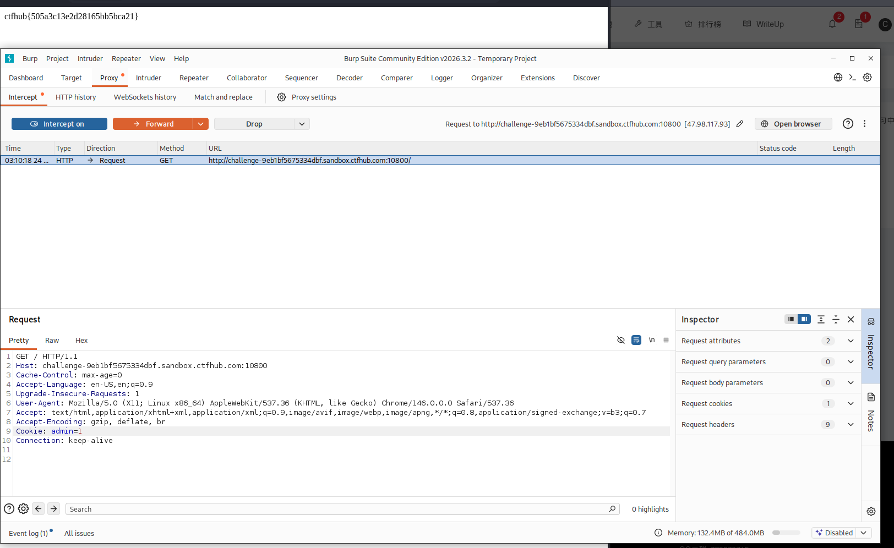

# WP：Cookie

> **CTFHub 路径**：技能树 → Web → Web 前置技能 → HTTP 协议 → Cookie
> **任务**：按题目提示修改 Cookie，拿到 flag。
> **提示**：在 DevTools 的 Application/Storage → Cookies 中查看 Cookie，或在 Burp 的请求头中查看。修改后重放请求，观察页面变化。
> **截图要求**：能看到修改后的 Cookie 请求头，以及服务器返回的 flag 或成功页面。

---

## 题目信息

| 项目 | 内容 |
| --- | --- |
| 环境地址 | http://challenge-9eb1bf5675334dbf.sandbox.ctfhub.com:10800 |
| Flag | ctfhub{505a3c13e2d28165bb5bca21} |

## 解题过程

访问环境后，我在请求头里看到了一个 `Cookie`，其中有个 `admin=0` 的字段。题目提示这个值控制着用户权限，我把请求抓到 Burp 里，把 `admin=0` 手动改成 `admin=1`，然后 Forward/重放这个请求。修改之后服务器返回的页面里就出现了 flag，说明服务器是根据 Cookie 里的这个值来判断权限的。

## 关键请求/响应

修改后的请求头：

```http
GET / HTTP/1.1
Host: challenge-9eb1bf5675334dbf.sandbox.ctfhub.com:10800
Cookie: admin=1
```

响应体中返回了 flag：

```
ctfhub{505a3c13e2d28165bb5bca21}
```

## 原理与复盘

Cookie 是存储在客户端、由浏览器每次请求时自动携带在请求头里的一小段数据，服务器靠它来识别用户身份和权限。本题的问题在于：服务器把"是否是管理员"这种权限判断，完全交给了客户端可控的 Cookie 值 `admin` 来决定，而且没有做校验。对应到 HTTP 报文，这属于请求头里的 Cookie 字段被客户端随意篡改，本质是把权限判断错误地放在了不可信的一端。

---

## 截图



> 可以在这份 WP 中另加过程截图；检查时只看指定图片，额外图片不检查。
