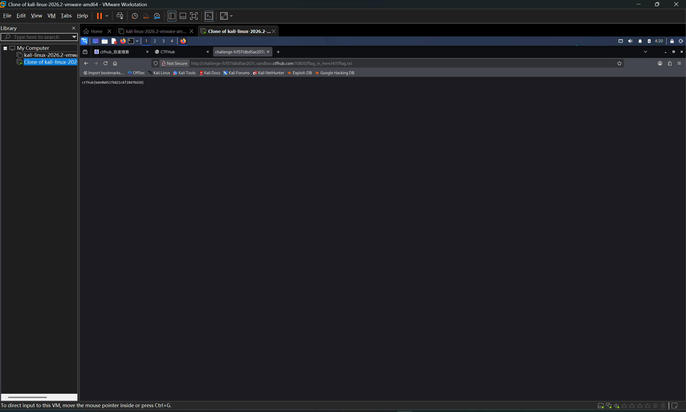

# WP：目录遍历

> **CTFHub 路径**：技能树 → Web → 信息泄露 → 目录遍历
> **任务**：按题目页面提示找到 flag。
> **提示**：注意页面给出的路径和 URL；目录列表本身就是一种信息泄露。只在题目环境内点击和访问，不要使用扫描器扫描其他地址。
> **截图要求**：能看到题目环境地址（或题目名称）、你访问的目录/路径，以及最终的 flag。

---

## 题目信息

| 项目 | 内容 |
| --- | --- |
| 环境地址 | http://challenge-fcf511dbd5ae207c.sandbox.ctfhub.com:10800 |
| Flag | ctfhub{bde9b651fb821c6f10d76d10} |

## 解题过程

打开题目环境后，页面提示 flag 藏在某个目录里，但首页并没有直接给出 flag。我沿着 URL 路径一层层往下找，先看到根目录下有一个 `flag_in_here` 目录，进入后里面又是若干层子目录（1、2、3、4……）。我逐个点进去看，最终在第 4 层子目录里发现了一个 `flag.txt` 文件，打开后就是 flag。整个过程中服务器开启了目录索引，把每个目录下的文件都列了出来，我顺着目录名一路点到底，没有用到扫描器，只在题目环境内访问。

## 关键请求/响应

```http
GET /flag_in_here/4/flag.txt HTTP/1.1
Host: challenge-fcf511dbd5ae207c.sandbox.ctfhub.com:10800
```

对应响应返回了 `200 OK`，响应体就是 flag 内容：

```
ctfhub{bde9b651fb821c6f10d76d10}
```

## 原理与复盘

这道题利用的是服务器的目录索引功能：当 Web 服务器没有配置默认首页（如 index.html）时，会把目录下的文件列表直接返回给客户端。目录列表本身属于信息泄露，它把本不该被直接看到的文件路径暴露了出来。本题的 flag 就藏在多级子目录里，我根据响应体里列出的目录名逐层下钻，最终定位到 `flag.txt`。对应到 HTTP 报文，这是响应体（目录列表 / 文件内容）泄露了敏感路径信息。

---

## 截图



> 可以在这份 WP 中另加过程截图；检查时只看指定图片，额外图片不检查。
