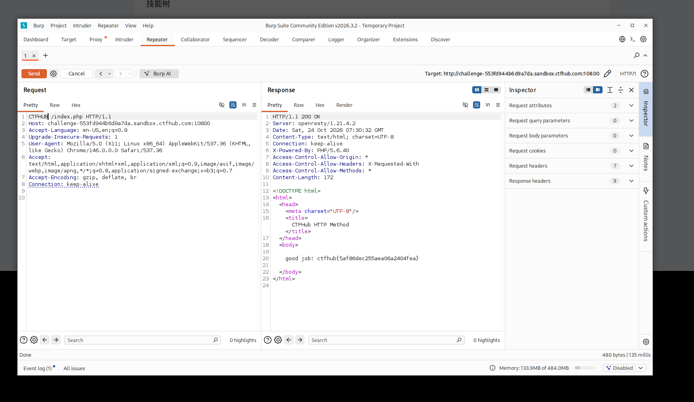

# WP：请求方式

> **CTFHub 路径**：技能树 → Web → Web 前置技能 → HTTP 协议 → 请求方式
> **任务**：按题目要求使用指定的 HTTP 方法访问目标，拿到 flag。
> **提示**：浏览器地址栏默认发送 GET 请求。用 Burp Repeater 修改请求行中的方法，或者用 `curl -X` 复现。
> **截图要求**：优先使用 Burp Repeater，截图中要能看到修改后的请求行（方法 + 路径）和响应中的 flag；如果 Burp 无法启动，可以用 `curl -X` 的方法修改截图代替，并在 WP 中说明原因。只有浏览器普通 GET 访问不算完成。

---

## 题目信息

| 项目 | 内容 |
| --- | --- |
| 环境地址 | http://challenge-553fd944b6d9a7da.sandbox.ctfhub.com:10800 |
| Flag | ctfhub{5af86dec255aea06a2404fea} |

## 解题过程

题目要求用指定的 HTTP 方法访问才能拿到 flag，而浏览器地址栏只能发 GET 请求。我先把请求抓到 Burp Suite 里，看到默认是 `GET /index.php HTTP/1.1`，此时服务器只返回了 "CTFHUB" 几个字，并没有 flag。于是我在 Burp Repeater 里把请求行开头的方法改成题目要求的 `CTFHUB`，重新 Send，这次响应里就出现了 flag。

## 关键请求/响应

请求行（修改方法后）：

```http
CTFHUB /index.php HTTP/1.1
Host: challenge-553fd944b6d9a7da.sandbox.ctfhub.com:10800
```

响应：

```
good job! ctfhub{5af86dec255aea06a2404fea}
```

## 原理与复盘

HTTP 请求行由"方法 + 路径 + 版本"三部分组成，方法（Method）位于请求行的最开头。服务器在处理请求时，会根据请求方法做不同处理，甚至能识别自定义的方法名。本题服务器只对特定方法名返回 flag，所以光用浏览器发 GET 是拿不到的。对应到 HTTP 报文，这道题利用/考查的是请求行里的请求方法字段，用 Burp Repeater 手动修改后重放即可。

---

## 截图



> 可以在这份 WP 中另加过程截图；检查时只看指定图片，额外图片不检查。
