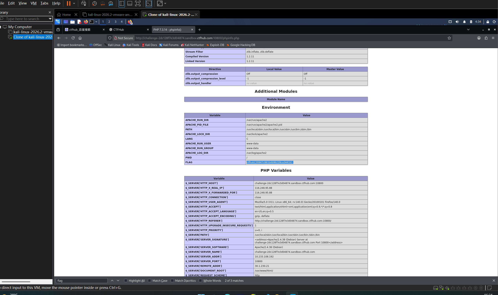

# WP：PHPINFO

> **CTFHub 路径**：技能树 → Web → 信息泄露 → PHPINFO
> **任务**：在 phpinfo 页面中找到 flag，并观察它泄露了哪些信息。
> **提示**：phpinfo 会输出大量 PHP 和服务器配置。用浏览器的查找功能搜索关键字，同时留意页面暴露的路径、版本、环境变量等信息。
> **截图要求**：能看到 phpinfo 页面、你搜索/定位到的 flag，以及至少一处敏感信息。

---

## 题目信息

| 项目 | 内容 |
| --- | --- |
| 环境地址 | http://challenge-2dc128f7e3d04874.sandbox.ctfhub.com:10800 |
| Flag | ctfhub{20947c861b4b9b228ca3441b} |

## 解题过程

打开环境后，页面直接输出了一整页 phpinfo 的信息，内容非常多，包括 PHP 版本、服务器软件、扩展模块、环境变量和 $_SERVER 数组等。我用浏览器自带的查找功能（Ctrl+F）在页面里搜索 "flag" 关键字，定位到了 flag 的位置。同时我也注意到页面暴露了大量敏感信息，比如 `Server API`、Apache 版本、`DOCUMENT_ROOT` 的绝对路径、`SERVER_SOFTWARE` 等，这些对攻击者来说都是可以利用的情报。

## 关键请求/响应

```http
GET /index.php HTTP/1.1
Host: challenge-2dc128f7e3d04874.sandbox.ctfhub.com:10800
```

响应体是 phpinfo 的输出，其中泄露了 `SERVER_SOFTWARE: Apache/2.4.38 (Debian)`、`PHP Version 7.2.x`、`DOCUMENT_ROOT` 等配置，并在环境变量里发现了 flag：

```
ctfhub{20947c861b4b9b228ca3441b}
```

## 原理与复盘

phpinfo() 是 PHP 自带的信息输出函数，它会一次性打印 PHP 的运行环境、服务器配置、环境变量等大量信息。如果在生产环境里不删除这样的调试页面，就等于把这些敏感信息主动暴露给任何人。本题的 flag 就藏在环境变量里，被 phpinfo 一并打印了出来。对应到 HTTP 报文，这是响应体泄露了服务器版本、绝对路径等配置信息，属于典型的信息泄露。

---

## 截图



> 可以在这份 WP 中另加过程截图；检查时只看指定图片，额外图片不检查。
