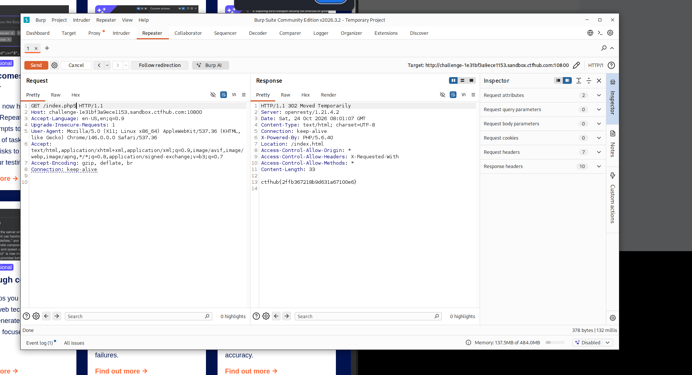

# WP：302 跳转

> **CTFHub 路径**：技能树 → Web → Web 前置技能 → HTTP 协议 → 302 跳转
> **任务**：观察 302 重定向，按题目提示找到 flag。
> **提示**：浏览器通常会自动跟随 302，所以你可能只看到最终页面。打开 DevTools 的 Network 面板（勾选 Preserve log）或 Burp，查看原始响应中的 `302` 状态码和 `Location` 响应头。
> **截图要求**：能看到 302 状态码和/或 `Location` 响应头，以及最终的 flag。只截最终页面、没有 302 证据的截图不合格。

---

## 题目信息

| 项目 | 内容 |
| --- | --- |
| 环境地址 | http://challenge-1e31bf3a9ece1153.sandbox.ctfhub.com:10800 |
| Flag | ctfhub{2ffb367218b9d631a67100e6} |

## 解题过程

第一次访问环境时，页面显示 "no flag here"，并没有 flag，同时给出了一个跳转提示。因为浏览器会自动跟随 302 跳转，直接把最终页面显示了出来，反而看不到中间的跳转过程。我用 Burp 抓包，看到服务器第一次返回的是 `302 Moved Temporarily`，并且在 `Location` 响应头里指向了 `/index.html`。我顺着这个 `Location` 地址再访问 `index.php`，才在响应体里找到了 flag。

## 关键请求/响应

第一次请求的原始响应：

```http
HTTP/1.1 302 Moved Temporarily
Server: openresty/1.21.4.2
Date: Sat, 24 Oct 2026 08:01:07 GMT
Content-Type: text/html; charset=UTF-8
Connection: keep-alive
X-Powered-By: PHP/5.6.40
Location: /index.html
Access-Control-Allow-Origin: *
Access-Control-Allow-Headers: X-Requested-With
Access-Control-Allow-Methods: *
Content-Length: 33
```

跟随 `Location` 访问后，响应体返回 flag：

```
ctfhub{2ffb367218b9d631a67100e6}
```

## 原理与复盘

HTTP 状态码 302 表示临时重定向，服务器通过 `Location` 响应头告诉客户端接下来该去哪个地址，浏览器会自动跟随这个跳转。这也解释了为什么第一次直接访问看不到 302——浏览器把跳转过程"吞掉"了，直接展示了最终页面。对应到 HTTP 报文，这道题考查的是状态行（302 状态码）和响应头（`Location` 字段）的配合，只有用 Burp/curl 看原始响应，才能看到重定向的完整过程。

---

## 截图



> 可以在这份 WP 中另加过程截图；检查时只看指定图片，额外图片不检查。
