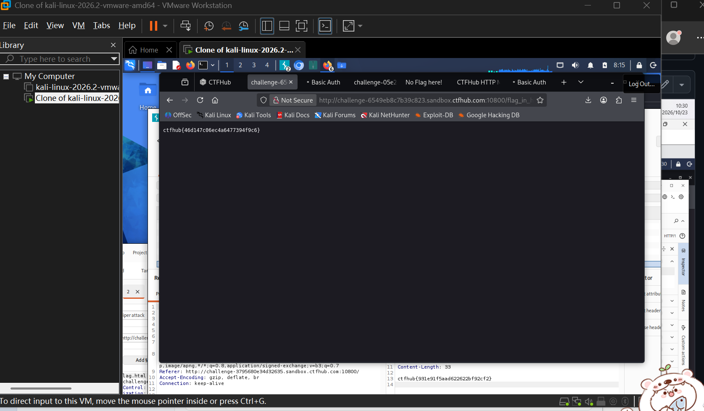

# WP：目录遍历

> **CTFHub 路径**：技能树 → Web → 信息泄露 → 目录遍历
> **任务**：按题目页面提示找到 flag。
> **提示**：注意页面给出的路径和 URL；目录列表本身就是一种信息泄露。只在题目环境内点击和访问，不要使用扫描器扫描其他地址。
> **截图要求**：能看到题目环境地址（或题目名称）、你访问的目录/路径，以及最终的 flag。

---

## 题目信息

| 项目 | 内容 |
| --- | --- |
| 环境地址 | http://challenge-6549eb8c7b39c823.sandbox.ctfhub.com:10800/ |
| Flag | `ctfhub{46d147c06ec4a6477394f9c6}` |

## 解题过程

开启题目后拿到靶场地址，直接访问首页，页面是一个文件管理风格的目录列表，把服务器上的目录结构直接列了出来。我按列表逐层点进去，先看到几个以数字命名的子目录，每个目录里又套着下一层目录，说明这题就是让我顺着目录一路翻下去。一直点到最深一层，看到一个以 flag 开头的文件，打开后页面直接输出了 flag。整个过程没有绕任何弯，纯粹是因为服务器把目录内容列给了访问者。

## 关键请求/响应

```http
GET / HTTP/1.1
Host: challenge-6549eb8c7b39c823.sandbox.ctfhub.com:10800

HTTP/1.1 200 OK
Content-Type: text/html; charset=UTF-8

<html>... 目录列表 ...</html>

（逐层进入子目录后，打开 flag 文件，地址形如 /flag_in_h3r3/... ，见截图地址栏）
HTTP/1.1 200 OK
Content-Length: 33

ctfhub{46d147c06ec4a6477394f9c6}
```

## 原理与复盘

这道题对应 HTTP 报文里请求行的 URL 路径部分：我把路径一层层往后加，就是在指定要访问哪个文件。Web 服务器默认会把没有首页文件的目录列成索引页，于是子目录名、文件名全部暴露，备份文件、源码、配置文件都可能被直接下载。防御方法是在服务器配置里关掉目录索引（如 Apache 的 Options -Indexes）。

---

## 截图



> 可以在这份 WP 中另加过程截图；检查时只看指定图片，额外图片不检查。

