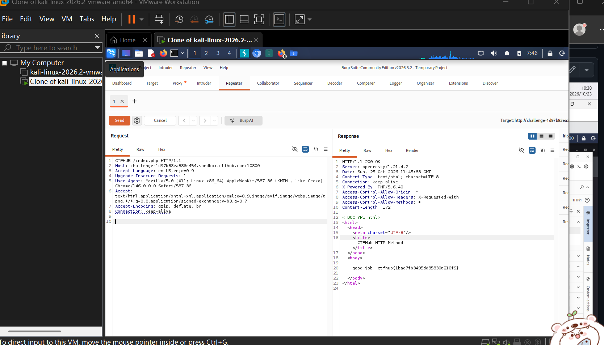

# WP：请求方式

> **CTFHub 路径**：技能树 → Web → Web 前置技能 → HTTP 协议 → 请求方式
> **任务**：按题目要求使用指定的 HTTP 方法访问目标，拿到 flag。
> **提示**：浏览器地址栏默认发送 GET 请求。用 Burp Repeater 修改请求行中的方法，或者用 `curl -X` 复现。
> **截图要求**：优先使用 Burp Repeater，截图中要能看到修改后的请求行（方法 + 路径）和响应中的 flag；如果 Burp 无法启动，可以用 `curl -X` 的方法修改截图代替，并在 WP 中说明原因。只有浏览器普通 GET 访问不算完成。

---

## 题目信息

| 项目 | 内容 |
| --- | --- |
| 环境地址 | http://challenge-1d97b83ea386e454.sandbox.ctfhub.com:10800/ |
| Flag | `ctfhub{1bad7fb3495dd85830a210f9}` |

## 解题过程

用浏览器直接访问靶场，页面提示要用题目指定的请求方法，而浏览器地址栏只会发 GET。我把这个请求发到 Burp Suite 的 Repeater，在左侧请求面板里把请求行的 GET 改成了 CTFHUB，路径 /index.php 和 HTTP/1.1 保持不变。点 Send 之后服务器返回 200 OK，响应体里是一段 HTML，中间写着 good job! 后面跟着 flag。用 curl -X CTFHUB 也能复现同样的结果。

## 关键请求/响应

```http
CTFHUB /index.php HTTP/1.1
Host: challenge-1d97b83ea386e454.sandbox.ctfhub.com:10800
Accept-Language: en-US,en;q=0.9
User-Agent: Mozilla/5.0 (X11; Linux x86_64) AppleWebKit/537.36 (KHTML, like Gecko) Chrome/146.0.0.0 Safari/537.36

HTTP/1.1 200 OK
Server: openresty/1.21.4.2
Content-Type: text/html; charset=UTF-8
X-Powered-By: PHP/5.6.40
Content-Length: 172

<html><head><title>CTFHub HTTP Method</title></head><body>good job! ctfhub{1bad7fb3495dd85830a210f9}</body></html>
```

## 原理与复盘

请求行由三个字段组成：方法、请求目标（路径）、HTTP 版本，中间用空格分开。方法只是第一个字段，HTTP 规范里虽然只定义了 GET/POST/PUT/DELETE 等标准方法，但服务器可以自己判断任何字符串，所以题目能用自定义方法做校验。浏览器只会按用户操作发标准方法，想改方法就必须用 Burp 或 curl 这类工具。

---

## 截图



> 可以在这份 WP 中另加过程截图；检查时只看指定图片，额外图片不检查。

