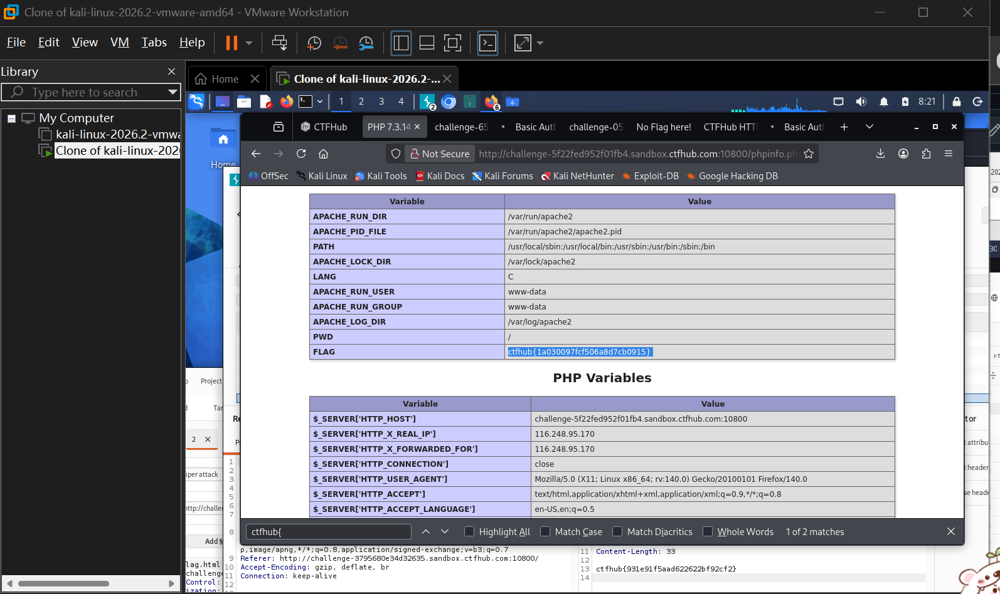

# WP：PHPINFO

> **CTFHub 路径**：技能树 → Web → 信息泄露 → PHPINFO
> **任务**：在 phpinfo 页面中找到 flag，并观察它泄露了哪些信息。
> **提示**：phpinfo 会输出大量 PHP 和服务器配置。用浏览器的查找功能搜索关键字，同时留意页面暴露的路径、版本、环境变量等信息。
> **截图要求**：能看到 phpinfo 页面、你搜索/定位到的 flag，以及至少一处敏感信息。

---

## 题目信息

| 项目 | 内容 |
| --- | --- |
| 环境地址 | http://challenge-5f22fed952f01fb4.sandbox.ctfhub.com:10800/phpinfo.php |
| Flag | `ctfhub{1a03009f7cf506a8d7cb0915}` |

## 解题过程

开启题目后拿到 phpinfo.php 的地址，打开就是一个标准的 phpinfo 页面，表格非常长。我先扫了一眼，能看到 PHP 版本、Apache 配置、各种路径。页面太长手动找不现实，就按 Ctrl+F 搜关键字 ctfhub，浏览器直接跳到了 PHP Variables 表里的 FLAG 一行，flag 就在 Value 列。同一页上还泄露了服务器绝对路径（/var/www/...）、PHP 5.6.40 版本号、运行用户 www-data、以及 $_SERVER 里的 Host 和 User-Agent 等请求信息。

## 关键请求/响应

```http
GET /phpinfo.php HTTP/1.1
Host: challenge-5f22fed952f01fb4.sandbox.ctfhub.com:10800

HTTP/1.1 200 OK
Content-Type: text/html; charset=UTF-8

<table>
  <tr><td>Variable</td><td>Value</td></tr>
  <tr><td>PWD</td><td>/</td></tr>
  <tr><td>FLAG</td><td>ctfhub{1a03009f7cf506a8d7cb0915}</td></tr>
  <tr><td>$_SERVER['HTTP_HOST']</td><td>challenge-5f22fed952f01fb4.sandbox.ctfhub.com:10800</td></tr>
</table>
```

## 原理与复盘

phpinfo() 的输出在响应体里，它把 PHP 的编译参数、模块、环境变量、请求头全部回显给访问者。这类信息本身不直接给权限，但绝对路径能配合文件包含和上传拿 shell，版本号能对上已知 CVE，数据库主机和账号前缀也常常在里面。生产环境上留着 phpinfo.php 是很典型的信息泄露。

---

## 截图



> 可以在这份 WP 中另加过程截图；检查时只看指定图片，额外图片不检查。

