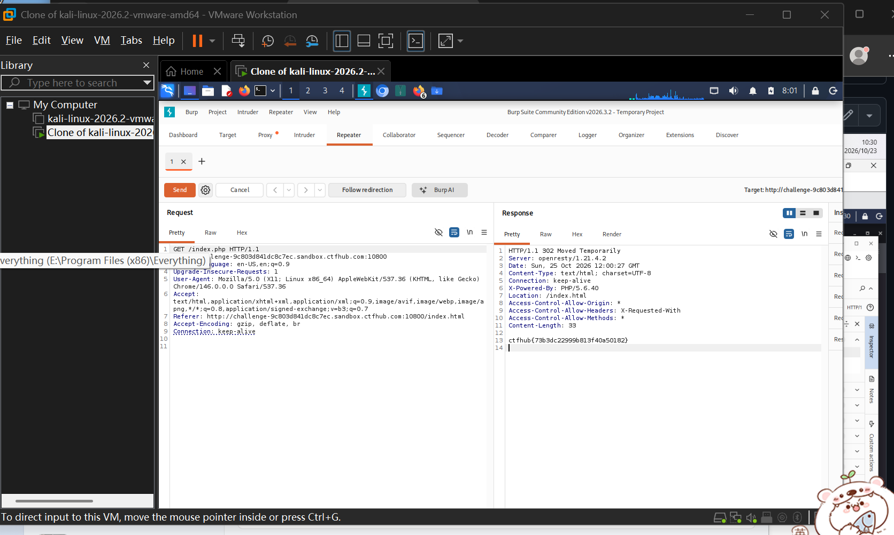

# WP：302 跳转

> **CTFHub 路径**：技能树 → Web → Web 前置技能 → HTTP 协议 → 302 跳转
> **任务**：观察 302 重定向，按题目提示找到 flag。
> **提示**：浏览器通常会自动跟随 302，所以你可能只看到最终页面。打开 DevTools 的 Network 面板（勾选 Preserve log）或 Burp，查看原始响应中的 `302` 状态码和 `Location` 响应头。
> **截图要求**：能看到 302 状态码和/或 `Location` 响应头，以及最终的 flag。只截最终页面、没有 302 证据的截图不合格。

---

## 题目信息

| 项目 | 内容 |
| --- | --- |
| 环境地址 | http://challenge-9c803d841dc8c7ec.sandbox.ctfhub.com:10800/ |
| Flag | `ctfhub{73b3dc22999b813f40a50182}` |

## 解题过程

在浏览器里访问靶场首页的 index.php，页面一闪就跳到了 index.html，只看到一句普通的提示，没有 flag。我判断这是重定向把中间过程藏起来了，于是把请求发到 Burp Repeater，先点掉工具栏的 Follow redirection，再 Send 一次。这次拿到的是 302 Moved Temporarily，响应头里 Location: /index.html，而响应体里直接就是 flag。所以我只要不跟随跳转，就能看到被浏览器丢掉的那一段内容。

## 关键请求/响应

```http
GET /index.php HTTP/1.1
Host: challenge-9c803d841dc8c7ec.sandbox.ctfhub.com:10800

HTTP/1.1 302 Moved Temporarily
Server: openresty/1.21.4.2
Content-Type: text/html; charset=utf-8
X-Powered-By: PHP/5.6.40
Location: /index.html
Content-Length: 33

ctfhub{73b3dc22999b813f40a50182}
```

## 原理与复盘

状态行 302 表示临时重定向，配合响应头 Location 告诉浏览器去哪里。浏览器的行为是自动再发一次请求，用户只看到最终页面，中间这次响应体被直接丢弃。200 则是正常返回，浏览器会把响应体渲染出来。所以同一份内容放在 302 的 body 里，用浏览器永远看不到，必须抓包或关掉跟随跳转。

---

## 截图



> 可以在这份 WP 中另加过程截图；检查时只看指定图片，额外图片不检查。

