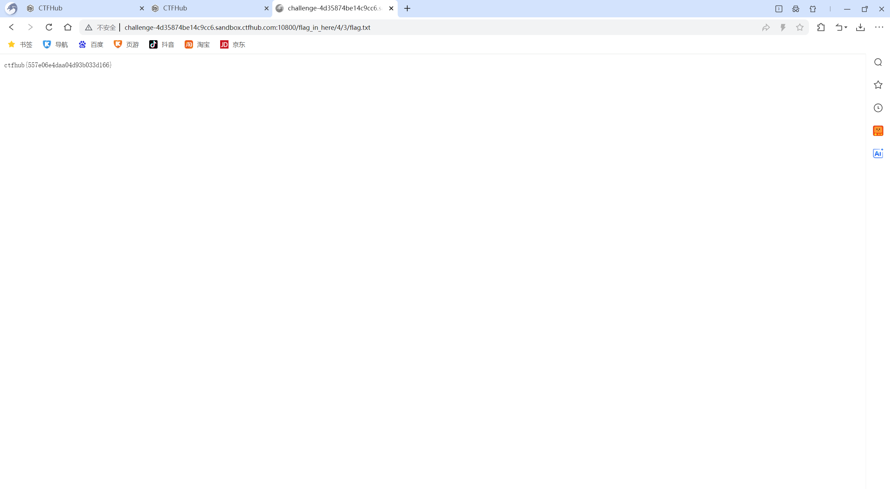

# WP：目录遍历

> **CTFHub 路径**：技能树 → Web → 信息泄露 → 目录遍历
> **任务**：按题目页面提示找到 flag。
> **提示**：注意页面给出的路径和 URL；目录列表本身就是一种信息泄露。只在题目环境内点击和访问，不要使用扫描器扫描其他地址。
> **截图要求**：能看到题目环境地址（或题目名称）、你访问的目录/路径，以及最终的 flag。

---

## 题目信息

| 项目 | 内容 |
| --- | --- |
| 环境地址 | http://challenge-4d35874be14c9cc6.sandbox.ctfhub.com:10800 |
| Flag | ctfhub{557e06e4daa04d93b033d166} |

## 解题过程

我打开靶场首页后，看到页面上只有一个 "flag in here/" 的目录列表入口，服务器直接把目录下的文件和子目录都列出来了。我逐层点进去：先进入 `flag_in_here/`，里面又列出了 0、1、2、3、4 等子目录，我就一层一层往下翻，像翻文件夹一样。最后在 `flag_in_here/4/2/` 这一层看到了一个 `flag.txt`，点开它，页面上直接显示了 flag。整个过程没有改任何请求，纯粹是顺着目录列表点进去的。

## 关键请求/响应

```http
本题不需要修改请求。关键访问路径如下（浏览器直接 GET）：

GET /flag_in_here/4/2/flag.txt HTTP/1.1
Host: challenge-4d35874be14c9cc6.sandbox.ctfhub.com:10800

响应状态码 200，响应体就是 flag：

ctfhub{557e06e4daa04d93b033d166}
```

## 原理与复盘

这道题对应 HTTP 请求行的 URL 路径部分：服务器开启了目录列表（autoindex），任何人只要在浏览器里输入路径就能看到目录下所有文件，相当于把网站的“文件柜”敞开了。目录列表会让备份文件、配置文件、敏感 txt 这类本不该暴露的内容被直接访问，属于典型的信息泄露。复盘时我意识到，实际渗透中遇到目录列表应该先翻一遍再决定下一步，而不是急着上扫描器。

---

## 截图



> 可以在这份 WP 中另加过程截图；检查时只看指定图片，额外图片不检查。

