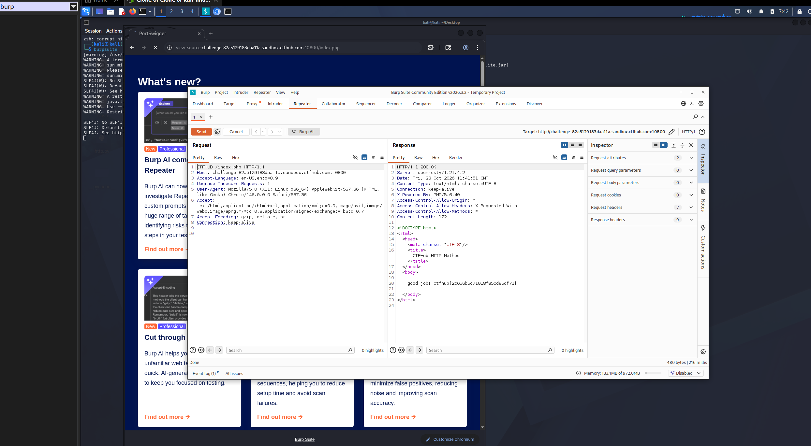

# WP：请求方式

> **CTFHub 路径**：技能树 → Web → Web 前置技能 → HTTP 协议 → 请求方式
> **任务**：按题目要求使用指定的 HTTP 方法访问目标，拿到 flag。
> **提示**：浏览器地址栏默认发送 GET 请求。用 Burp Repeater 修改请求行中的方法，或者用 `curl -X` 复现。
> **截图要求**：优先使用 Burp Repeater，截图中要能看到修改后的请求行（方法 + 路径）和响应中的 flag；如果 Burp 无法启动，可以用 `curl -X` 的方法修改截图代替，并在 WP 中说明原因。只有浏览器普通 GET 访问不算完成。

---

## 题目信息

| 项目 | 内容 |
| --- | --- |
| 环境地址 | http://challenge-82a5129183daa11a.sandbox.ctfhub.com:10800 |
| Flag | ctfhub{2c656b5c71018f850d85df71} |

## 解题过程

我先在 Kali 的浏览器里打开靶场，页面提示 "You can only use CTFHUB method to request"，也就是说服务器只接受方法名为 CTFHUB 的请求，而浏览器地址栏只会发 GET。于是我打开 Burp Suite，把浏览器请求发到 Repeater，在请求面板里把请求行第一段的 GET 改成 CTFHUB，其他头保持不变，点击 Send。响应返回 200 OK，响应体里出现 "good job!" 和 flag，说明服务器确实按方法名做了判断。

## 关键请求/响应

```http
修改后的请求行（Burp Repeater 发送）：

CTFHUB /index.php HTTP/1.1
Host: challenge-82a5129183daa11a.sandbox.ctfhub.com:10800

服务器响应：

HTTP/1.1 200 OK
Content-Type: text/html; charset=UTF-8

...
good job! ctfhub{2c656b5c71018f850d85df71}
```

## 原理与复盘

这道题对应请求行：请求行由“方法 + 路径 + HTTP 版本”三部分组成，方法位于请求行的最前面。HTTP 方法本质只是一个大小写敏感的字符串，服务器完全可以自定义（比如本题的 CTFHUB），浏览器没有入口发这种请求，就必须用 Burp 或 curl 在请求行上动手。复盘时我体会到，方法名可控意味着服务端对请求方法的白名单校验很重要，否则任意方法都可能触发不同分支的逻辑。

---

## 截图



> 可以在这份 WP 中另加过程截图；检查时只看指定图片，额外图片不检查。

