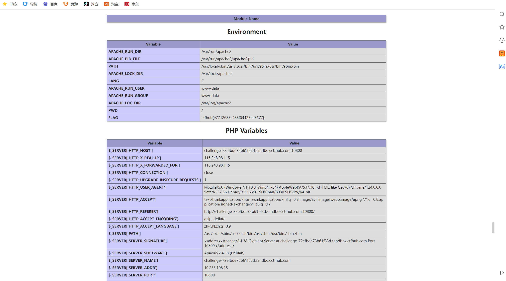

# WP：PHPINFO

> **CTFHub 路径**：技能树 → Web → 信息泄露 → PHPINFO
> **任务**：在 phpinfo 页面中找到 flag，并观察它泄露了哪些信息。
> **提示**：phpinfo 会输出大量 PHP 和服务器配置。用浏览器的查找功能搜索关键字，同时留意页面暴露的路径、版本、环境变量等信息。
> **截图要求**：能看到 phpinfo 页面、你搜索/定位到的 flag，以及至少一处敏感信息。

---

## 题目信息

| 项目 | 内容 |
| --- | --- |
| 环境地址 | http://challenge-72efbde73b61f83d.sandbox.ctfhub.com:10800 |
| Flag | ctfhub{e7712683c485f04425ee8677} |

## 解题过程

我打开靶场地址后直接就是一个完整的 phpinfo() 页面，信息非常长。我先用浏览器 Ctrl+F 搜索 "FLAG"，很快在 Environment 表格里找到一行 VARIABLE 叫 FLAG，对应的 Value 就是 flag。同时我注意到这个页面还暴露了大量敏感信息：服务器是 Apache/2.4.38 (Debian)，`$_SERVER['HTTP_HOST']` 暴露了真实域名，`DOCUMENT_ROOT` 暴露了网站根目录路径 `/var/www/html`，环境变量表里甚至能看到容器内部的配置。flag 就这样明晃晃地写在环境变量里。

## 关键请求/响应

```http
本题不需要修改请求。直接 GET 首页即可：

GET / HTTP/1.1
Host: challenge-72efbde73b61f83d.sandbox.ctfhub.com:10800

响应 200，phpinfo 页面的 Environment 表格中：

Variable    Value
FLAG        ctfhub{e7712683c485f04425ee8677}
```

## 原理与复盘

phpinfo 页面对应 HTTP 响应体部分：它把 PHP 的版本、扩展、环境变量、服务器路径等配置全部输出给任何访问者。这些信息对攻击者非常有用——版本号可以查已知漏洞，绝对路径可以帮助构造路径穿越或上传 payload，环境变量里可能直接藏着密码或像本题一样的 flag。这道题让我明白，生产环境必须关闭 debug 类页面，信息泄露往往就是后续攻击的起点。

---

## 截图



> 可以在这份 WP 中另加过程截图；检查时只看指定图片，额外图片不检查。

