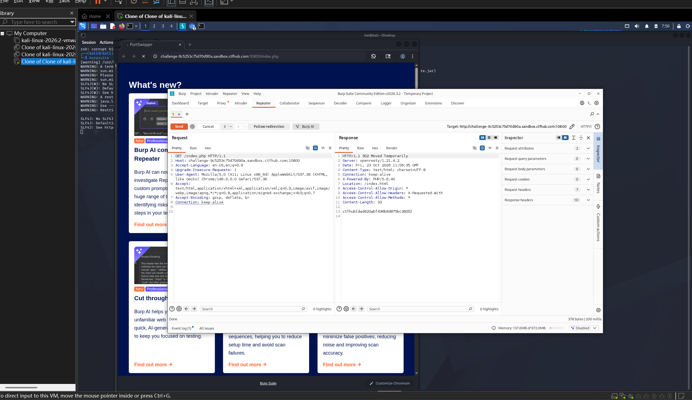

# WP：302 跳转

> **CTFHub 路径**：技能树 → Web → Web 前置技能 → HTTP 协议 → 302 跳转
> **任务**：观察 302 重定向，按题目提示找到 flag。
> **提示**：浏览器通常会自动跟随 302，所以你可能只看到最终页面。打开 DevTools 的 Network 面板（勾选 Preserve log）或 Burp，查看原始响应中的 `302` 状态码和 `Location` 响应头。
> **截图要求**：能看到 302 状态码和/或 `Location` 响应头，以及最终的 flag。只截最终页面、没有 302 证据的截图不合格。

---

## 题目信息

| 项目 | 内容 |
| --- | --- |
| 环境地址 | http://challenge-b32b25cf976d009a.sandbox.ctfhub.com:10800 |
| Flag | ctfhub{dad620abf436b83875bc3605} |

## 解题过程

我在 Kali 浏览器里打开靶场，页面闪了一下就落在 index.html 上，看上去只是一个普通页面，完全看不到 flag——因为浏览器自动跟随了跳转。于是我把对 `/index.php` 的请求抓到 Burp 的 Repeater 里重放，这次不跟随跳转，直接看原始响应：状态行是 `HTTP/1.1 302 Moved Temporarily`，响应头里有 `Location: /index.html`，而在响应体里，flag 就明晃晃地写着。原来服务器把 flag 直接放在 302 响应体里返回了，浏览器跟随跳转时根本不会把它显示出来。

## 关键请求/响应

```http
GET /index.php HTTP/1.1
Host: challenge-b32b25cf976d009a.sandbox.ctfhub.com:10800

HTTP/1.1 302 Moved Temporarily
Server: openresty/1.21.4.2
Content-Type: text/html; charset=UTF-8
Location: /index.html
Content-Length: 33

ctfhub{dad620abf436b83875bc3605}
```

## 原理与复盘

这道题对应状态行和响应头：302 是临时重定向，服务器通过 `Location` 响应头告诉浏览器下一个地址，浏览器收到后会立刻自动发起新请求，用户只会看到最终页面。而 Burp/curl 这类工具不会自动跟随，所以能看到原始响应——flag 就藏在被浏览器“跳过”的响应体里。复盘时我认识到，调试重定向问题时一定要用能关闭自动跳转的工具（curl 默认不跟随，加 `-L` 才跟随），不然很多中间响应里的信息会被吞掉。

---

## 截图



> 可以在这份 WP 中另加过程截图；检查时只看指定图片，额外图片不检查。

