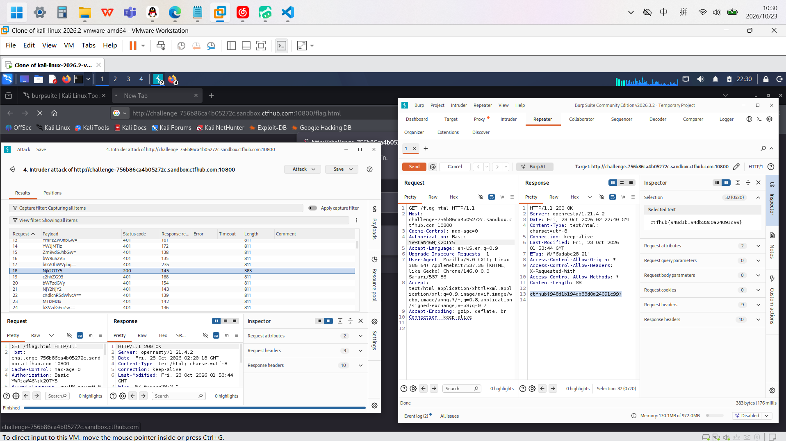

# WP：基础认证

> **CTFHub 路径**：技能树 → Web → Web 前置技能 → HTTP 协议 → 基础认证
> **任务**：按题目提示完成 HTTP Basic 认证，拿到 flag。
> **提示**：观察 `401 Unauthorized` 响应和 `WWW-Authenticate: Basic` 响应头。Basic 认证把 `用户名:密码` 做 Base64 编码后放在 `Authorization` 请求头里，Base64 不是加密。
> **截图要求**：能看到 `Authorization: Basic ...` 请求头，以及认证成功后的 flag 或页面。

---

## 题目信息

| 项目 | 内容 |
| --- | --- |
| 环境地址 | http://challenge-756b86ca4b05272c.sandbox.ctfhub.com:10800/ |
| Flag | ctfhub{948d1b194db33d0a24091c99} |

## 解题过程

开启题目后点击页面链接，服务器对 `flag.html` 返回 `401 Unauthorized`，响应头中带 `WWW-Authenticate: Basic realm="Do u know admin ?"`，浏览器弹出用户名/密码登录框，说明这是 HTTP Basic 认证。我先随便填了一组用户名密码，在 Burp 里抓到请求头多了一行 `Authorization: Basic ...`，Base64 解码正好是 `用户名:密码`，验证了它只是编码、没有加密。题目附件是一个常见弱口令字典，于是我把请求发到 Intruder，把 `Basic ` 后面那串编码设为 payload 位置，在 Payload processing 里先加前缀 `admin:`、再做 Base64 编码，并取消 URL 编码（否则编码后的 `=` 会被转成 `%3D` 导致服务端解不开）。开始攻击后按状态码排序，绝大多数是 401，只有一条返回 `200 OK`，对应密码 `696969`，其 `Authorization: Basic YWRtaW46Njk2OTY5` 解码正是 `admin:696969`。用它重放请求，响应体中直接返回了 flag。

## 关键请求/响应

```http
GET /flag.html HTTP/1.1
Host: challenge-756b86ca4b05272c.sandbox.ctfhub.com:10800
Authorization: Basic YWRtaW46Njk2OTY5
Connection: keep-alive

HTTP/1.1 200 OK
Server: openresty/1.21.4.2
Content-Type: text/html; charset=UTF-8
X-Powered-By: PHP/5.6.40

ctfhub{948d1b194db33d0a24091c99}
```

> 说明：`YWRtaW46Njk2OTY5` 就是 `base64("admin:696969")`，Base64 只是编码，解码即可还原出用户名和密码。

## 原理与复盘

这道题对应 HTTP 报文的 **请求头 Authorization**。Basic 认证只是把 `用户名:密码` 用 Base64 编码后放在请求头里传输；Base64 不是加密，只是编码，任何人拿到后都能解码还原出原始明文。因此弱口令 + Basic 认证非常危险，攻击者一旦截获请求或直接猜测密码就能绕过认证。

---

## 截图



> 可以在这份 WP 中另加过程截图；检查时只看指定图片，额外图片不检查。
