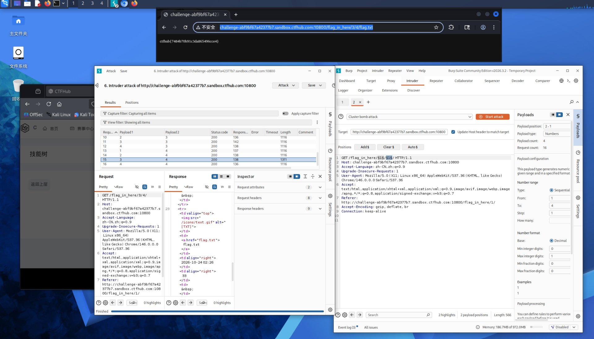

# WP：目录遍历

> **CTFHub 路径**：技能树 → Web → 信息泄露 → 目录遍历
> **任务**：按题目页面提示找到 flag。
> **提示**：注意页面给出的路径和 URL；目录列表本身就是一种信息泄露。只在题目环境内点击和访问，不要使用扫描器扫描其他地址。
> **截图要求**：能看到题目环境地址（或题目名称）、你访问的目录/路径，以及最终的 flag。

---

## 题目信息

| 项目 | 内容 |
| --- | --- |
| 环境地址 | http://challenge-ab9f8f67a4237f67.sandbox.ctfhub.com:10800/ |
| Flag | ctfhub{7484b70b91c3da865496cce4} |

## 解题过程

开启题目后访问靶场首页 `/flag_in_here/`，页面是目录索引（autoindex），列出若干以数字命名的子目录。按「目录遍历」的思路，我顺着目录一层层往下点；由于目录层级较深、组合较多，为了更快定位，我也用 Burp Intruder 对目录名做了数字字典爆破，通过响应长度差异区分命中的目录列表页和 404。最终定位到 `/flag_in_here/3/4/` 目录，里面有一个 `flag.txt`，在浏览器打开 `http://challenge-ab9f8f67a4237f67.sandbox.ctfhub.com:10800/flag_in_here/3/4/flag.txt`，页面直接显示出了 flag。

## 关键请求/响应

```http
GET /flag_in_here/3/4/flag.txt HTTP/1.1
Host: challenge-ab9f8f67a4237f67.sandbox.ctfhub.com:10800

HTTP/1.1 200 OK
Content-Type: text/plain

ctfhub{7484b70b91c3da865496cce4}
```

（目录路径为 `/flag_in_here/3/4/flag.txt`；本题不需要修改请求头或请求方法，关键是顺着目录索引逐层遍历。）

## 原理与复盘

这道题对应 HTTP 报文中的 **URL 路径**。Web 服务器配置为允许目录列表时，会把目录下的文件和子目录直接列在响应体中返回给客户端。攻击者通过逐层遍历这些目录，就能发现原本不想公开的敏感文件（如备份、源码、flag 文件），这就是典型的信息泄露。

---

## 截图



> 可以在这份 WP 中另加过程截图；检查时只看指定图片，额外图片不检查。
