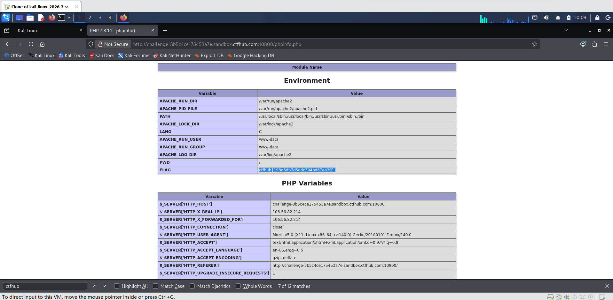

# WP：PHPINFO

> **CTFHub 路径**：技能树 → Web → 信息泄露 → PHPINFO
> **任务**：在 phpinfo 页面中找到 flag，并观察它泄露了哪些信息。
> **提示**：phpinfo 会输出大量 PHP 和服务器配置。用浏览器的查找功能搜索关键字，同时留意页面暴露的路径、版本、环境变量等信息。
> **截图要求**：能看到 phpinfo 页面、你搜索/定位到的 flag，以及至少一处敏感信息。

---

## 题目信息

| 项目 | 内容 |
| --- | --- |
| 环境地址 | http://challenge-3b5c4ce175453a7e.sandbox.ctfhub.com:10800/phpinfo.php |
| Flag | ctfhub{193d5db7d5ddc394bd67ea30} |

## 解题过程

开启题目后，根据提示直接访问 `/phpinfo.php`，页面是 PHP 7.3.14 的 `phpinfo()` 输出，包含大量服务器配置信息。由于页面很长，我用查找功能（浏览器 `Ctrl + F`，或 Burp 响应面板的搜索框）搜索关键字 `ctfhub`，很快命中多处，其中一处是 `FLAG` 字段，值就是 `ctfhub{193d5db7d5ddc394bd67ea30}`。同时页面还暴露了 PHP 版本、Server API、DOCUMENT_ROOT、环境变量等敏感信息。

## 关键请求/响应

```http
GET /phpinfo.php HTTP/1.1
Host: challenge-3b5c4ce175453a7e.sandbox.ctfhub.com:10800

HTTP/1.1 200 OK
Content-Type: text/html; charset=UTF-8

...
<tr><td class="e">FLAG</td><td class="v">ctfhub{193d5db7d5ddc394bd67ea30}</td></tr>
...
```

## 原理与复盘

phpinfo 页面属于 **响应体** 信息泄露。它会无差别地输出 PHP 运行环境、服务器路径、扩展版本、环境变量等敏感配置。攻击者可以利用这些信息判断服务器是否存在已知漏洞、定位 Web 根目录、构造后续攻击 payload。

---

## 截图



> 可以在这份 WP 中另加过程截图；检查时只看指定图片，额外图片不检查。
