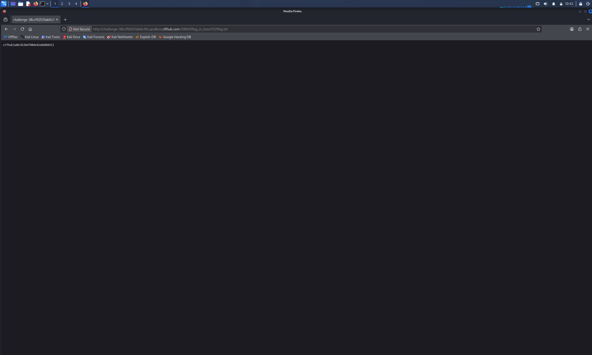

# WP：目录遍历

> **CTFHub 路径**：技能树 → Web → 信息泄露 → 目录遍历
> **任务**：按题目页面提示找到 flag。
> **提示**：注意页面给出的路径和 URL；目录列表本身就是一种信息泄露。只在题目环境内点击和访问，不要使用扫描器扫描其他地址。
> **截图要求**：能看到题目环境地址（或题目名称）、你访问的目录/路径，以及最终的 flag。

---

## 题目信息

| 项目 | 内容 |
| --- | --- |
| 环境地址 | http://challenge-38ccf92533ab6c90.sandbox.ctfhub.com:10800 |
| Flag | ctfhub{ad6c913bd700de42e8dd6031} |

## 解题过程

开启环境后先用浏览器访问靶场首页，页面提示 flag 就藏在 `/flag_in_here/` 目录下面。直接访问 `/flag_in_here/` 时，服务器没有返回 403 或 404，而是返回了一个目录列表页面（Index of），把下面的数字子目录全部列了出来。我逐层点进去，发现里面还嵌套着更深一层的数字目录（1/、2/ 这样一层套一层），手点很慢。于是我在 Kali 终端里写了一个简单的 Python 脚本，抓取每个目录列表页里的 `<a href>` 链接做递归遍历，把整棵目录树都打印出来，最终确认 flag 文件在 `/flag_in_here/1/2/flag.txt`。在浏览器地址栏直接访问这个路径，页面显示出了 flag，提交后平台提示 flag 正确。

## 关键请求/响应

```http
GET /flag_in_here/1/2/flag.txt HTTP/1.1
Host: challenge-38ccf92533ab6c90.sandbox.ctfhub.com:10800

HTTP/1.1 200 OK
Content-Type: text/plain

ctfhub{ad6c913bd700de42e8dd6031}
```

中间每访问一层目录（如 `GET /flag_in_here/1/`）都会返回目录列表 HTML，列表里的 `<a href>` 就是下一层的入口，本题没有修改请求。

## 原理与复盘

这道题对应 HTTP 报文中的 **URL 路径** 部分：服务器（Nginx 的 autoindex）在请求路径没有默认首页文件时，会把目录内容列成 HTML 放在响应体里返回。目录列表把服务器上的文件结构完整暴露给访问者，攻击者顺着链接就能逐层找到备份、源码、配置等敏感文件，属于典型的信息泄露。复盘时我意识到：只要目录列表没关，连扫描器都不需要，顺着页面链接就能把整个站点翻个底朝天。

---

## 截图



> 可以在这份 WP 中另加过程截图；检查时只看指定图片，额外图片不检查。
