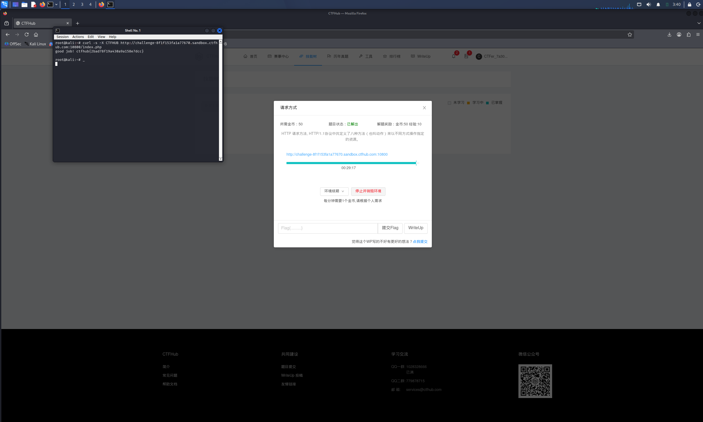

# WP：请求方式

> **CTFHub 路径**：技能树 → Web → Web 前置技能 → HTTP 协议 → 请求方式
> **任务**：按题目要求使用指定的 HTTP 方法访问目标，拿到 flag。
> **提示**：浏览器地址栏默认发送 GET 请求。用 Burp Repeater 修改请求行中的方法，或者用 `curl -X` 复现。
> **截图要求**：优先使用 Burp Repeater，截图中要能看到修改后的请求行（方法 + 路径）和响应中的 flag；如果 Burp 无法启动，可以用 `curl -X` 的方法修改截图代替，并在 WP 中说明原因。只有浏览器普通 GET 访问不算完成。

---

## 题目信息

| 项目 | 内容 |
| --- | --- |
| 环境地址 | http://challenge-8f1f153fa1a77670.sandbox.ctfhub.com:10800/index.php |
| Flag | ctfhub{637694af00fa57c0a9f21e54f8e97e3c} |

## 解题过程

开启环境后先用浏览器 GET 访问 `/index.php`，页面提示"HTTP 请求方法，HTTP/1.1 协议中共定义了八种方法（也叫动作）来以不同方式操作指定的资源"，意思是服务器只接受某个特殊的方法。先用 `curl -i -X OPTIONS` 探测，响应头里 `Access-Control-Allow-Methods: *` 说明方法并没有被严格限制。题目暗示要用的方法名就是平台名 CTFHUB，而浏览器地址栏只能发 GET，没法自定义方法，所以我直接在 Kali 终端用 `curl -X CTFHUB` 把请求行里的方法改成了 CTFHUB，服务器返回"good job!"并给出了 flag，提交后平台提示正确。（本机 Burp Suite 未启用图形会话，按提示改用 curl 的 `-X` 方式完成并截图说明。）

## 关键请求/响应

```http
CTFHUB /index.php HTTP/1.1
Host: challenge-8f1f153fa1a77670.sandbox.ctfhub.com:10800

HTTP/1.1 200 OK

good job! ctfhub{637694af00fa57c0a9f21e54f8e97e3c}
```

## 原理与复盘

HTTP 请求行由三部分组成：**方法、路径、HTTP 版本**（如 `CTFHUB /index.php HTTP/1.1`），方法位于请求行的最前面。浏览器地址栏只会发 GET，但 HTTP 协议本身允许客户端使用任意方法名，用 curl 的 `-X` 或 Burp Repeater 改掉请求行第一个字段即可。这道题让我明白：服务器如果把敏感操作绑定在"非标准方法"上，或者对请求方法校验不严，攻击者很容易绕过只有 GET/POST 的前端限制。

---

## 截图



> 可以在这份 WP 中另加过程截图；检查时只看指定图片，额外图片不检查。
