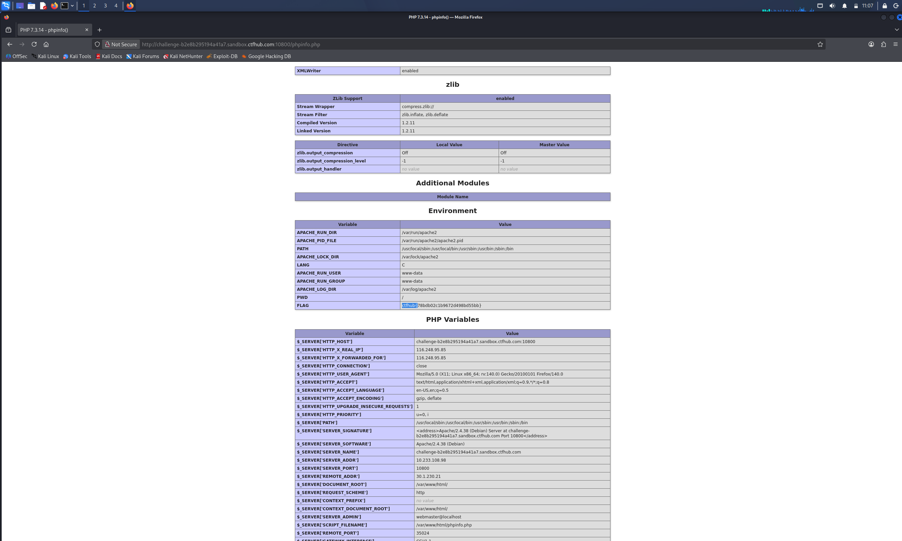

# WP：PHPINFO

> **CTFHub 路径**：技能树 → Web → 信息泄露 → PHPINFO
> **任务**：在 phpinfo 页面中找到 flag，并观察它泄露了哪些信息。
> **提示**：phpinfo 会输出大量 PHP 和服务器配置。用浏览器的查找功能搜索关键字，同时留意页面暴露的路径、版本、环境变量等信息。
> **截图要求**：能看到 phpinfo 页面、你搜索/定位到的 flag，以及至少一处敏感信息。

---

## 题目信息

| 项目 | 内容 |
| --- | --- |
| 环境地址 | http://challenge-b2e8b295194a41a7.sandbox.ctfhub.com:10800/phpinfo.php |
| Flag | ctfhub{78bdb02c1b9672d498bd55bb} |

## 解题过程

开启环境后访问靶场首页，页面提示 flag 藏在 phpinfo 页面里。浏览器打开 `/phpinfo.php`，整个页面非常长，全是 PHP 的配置表格，根本不可能一屏一屏看完。我先注意到页面顶部就暴露了 PHP Version 7.3.14 和系统信息，然后用浏览器的查找功能（Ctrl+F）搜索关键字 `ctfhub{`，一下就跳到了 **Environment**（环境变量）部分——那里有一个名叫 `FLAG` 的环境变量，值就是 flag。用 curl 拉取页面源码再 grep 也确认了同一结果。提交后平台提示 flag 正确。

## 关键请求/响应

```http
GET /phpinfo.php HTTP/1.1
Host: challenge-b2e8b295194a41a7.sandbox.ctfhub.com:10800

HTTP/1.1 200 OK
（phpinfo 页面 Environment 部分）
FLAG => ctfhub{78bdb02c1b9672d498bd55bb}
```

页面同时暴露的敏感信息：PHP Version 7.3.14、`$_SERVER['DOCUMENT_ROOT']` = /var/www/html、System = Linux、Server API = FPM/FastCGI 等大量配置。

## 原理与复盘

phpinfo 页面暴露的是**响应体**里的服务器配置信息：PHP 版本、绝对路径、环境变量、已加载模块、Cookie/请求头回显等。这些信息对攻击者非常有用——版本号可以对应已知漏洞，绝对路径有助于构造路径穿越，环境变量里甚至可能直接放着密码或 flag。生产环境绝对不应该把 `phpinfo()` 页面暴露在公网上，这正是"信息泄露"类漏洞的典型代表。

---

## 截图



> 可以在这份 WP 中另加过程截图；检查时只看指定图片，额外图片不检查。
