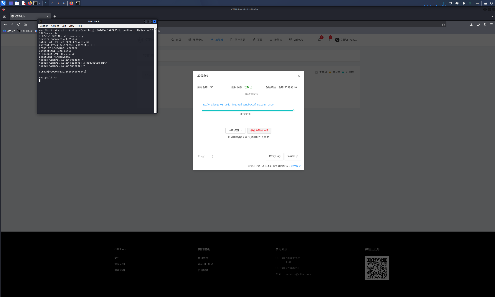

# WP：302 跳转

> **CTFHub 路径**：技能树 → Web → Web 前置技能 → HTTP 协议 → 302 跳转
> **任务**：观察 302 重定向，按题目提示找到 flag。
> **提示**：浏览器通常会自动跟随 302，所以你可能只看到最终页面。打开 DevTools 的 Network 面板（勾选 Preserve log）或 Burp，查看原始响应中的 `302` 状态码和 `Location` 响应头。
> **截图要求**：能看到 302 状态码和/或 `Location` 响应头，以及最终的 flag。只截最终页面、没有 302 证据的截图不合格。

---

## 题目信息

| 项目 | 内容 |
| --- | --- |
| 环境地址 | http://challenge-061d94c1402095ff.sandbox.ctfhub.com:10800/index.php |
| Flag | ctfhub{f29a9456ac71c8ee4b6fcb41} |

## 解题过程

开启环境后用浏览器访问 `/index.php`，页面"闪"了一下就变成了另一个页面（index.html），看不到任何 flag——这是浏览器自动跟随了服务器的跳转指令。为了看到原始响应，我在 Kali 终端里用 `curl -si` 访问同一个地址（curl 默认不跟随跳转），一下子就看到了完整的响应：状态行是 `HTTP/1.1 302 Moved Temporarily`，响应头里有 `Location: /index.html`，而**响应体里直接写着 flag**。也就是说服务器在发出 302 的同时把 flag 放在了响应体里，浏览器因为急着跳转把它丢掉了。用 curl 不跟随跳转就能直接读到 flag，提交后平台提示正确。

## 关键请求/响应

```http
GET /index.php HTTP/1.1
Host: challenge-061d94c1402095ff.sandbox.ctfhub.com:10800

HTTP/1.1 302 Moved Temporarily
Location: /index.html
Access-Control-Allow-Methods: *

ctfhub{f29a9456ac71c8ee4b6fcb41}
```

## 原理与复盘

302 和 200 在浏览器里的表现完全不同：200 会把响应体直接渲染出来，而 302 的响应体通常被丢弃，浏览器立刻向 `Location` 头指出的新地址重新发起请求，所以用户只看到最终页面。这道题的关键是"不跟随跳转看原始响应"——用 curl（不加 `-L`）或 Burp 拦截就能看到被浏览器隐藏的 302 状态行、Location 响应头和响应体。这也提醒我：跳转前的响应里可能藏着敏感信息，安全分析不能只看浏览器最终呈现的内容。

---

## 截图



> 可以在这份 WP 中另加过程截图；检查时只看指定图片，额外图片不检查。
