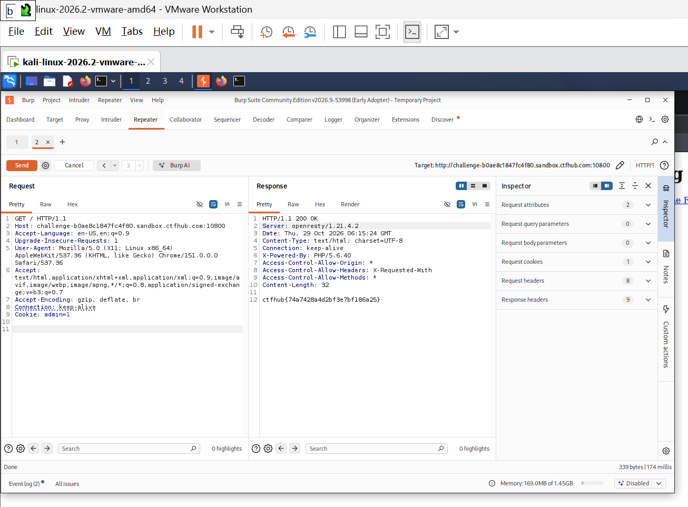

# WP：Cookie

> **CTFHub 路径**：技能树 → Web → Web 前置技能 → HTTP 协议 → Cookie
> **任务**：按题目提示修改 Cookie，拿到 flag。
> **提示**：在 DevTools 的 Application/Storage → Cookies 中查看 Cookie，或在 Burp 的请求头中查看。修改后重放请求，观察页面变化。
> **截图要求**：能看到修改后的 Cookie 请求头，以及服务器返回的 flag 或成功页面。

---

## 题目信息

| 项目 | 内容 |
| --- | --- |
| 环境地址 | http://challenge-b0ae81847fc4f80.sandbox.ctfhub.com:10800/ |
| Flag | ctfhub{74a7428a4d2bf3e7bf186a25} |

## 解题过程

先用浏览器访问环境地址，页面提示“只有 admin 可以得到 flag”，同时能看到当前请求带着一个 Cookie。我用 Burp 抓包后查看请求头，发现 Cookie 是 `admin=0`，也就是说服务器只根据这个 Cookie 的值来判断是不是管理员。我把请求发送到 Repeater，把请求头改成 `Cookie: admin=1`，点击 Send 重放，响应从原来的提示文字变成了 flag：`ctfhub{74a7428a4d2bf3e7bf186a25}`，提交后平台确认正确。

## 关键请求/响应

```http
GET / HTTP/1.1
Host: challenge-b0ae81847fc4f80.sandbox.ctfhub.com:10800
Cookie: admin=1

HTTP/1.1 200 OK
Content-Type: text/html; charset=UTF-8
X-Powered-By: PHP/5.6.40

ctfhub{74a7428a4d2bf3e7bf186a25}
```

## 原理与复盘

这道题对应 HTTP 报文的请求头：Cookie 放在请求头里随每次请求发送给服务器，服务器通常靠它来识别“你是谁”。但本题把管理员判断直接建立在客户端可随意修改的 Cookie 值上，`admin=0` 改成 `admin=1` 就能伪造管理员身份，属于典型的“权限判断放错位置”。复盘结论：Cookie 只适合存放客户端状态，真正的权限校验必须放在服务端的 Session 里，不能信任客户端传来的任何字段。

---

## 截图



> 可以在这份 WP 中另加过程截图；检查时只看指定图片，额外图片不检查。
