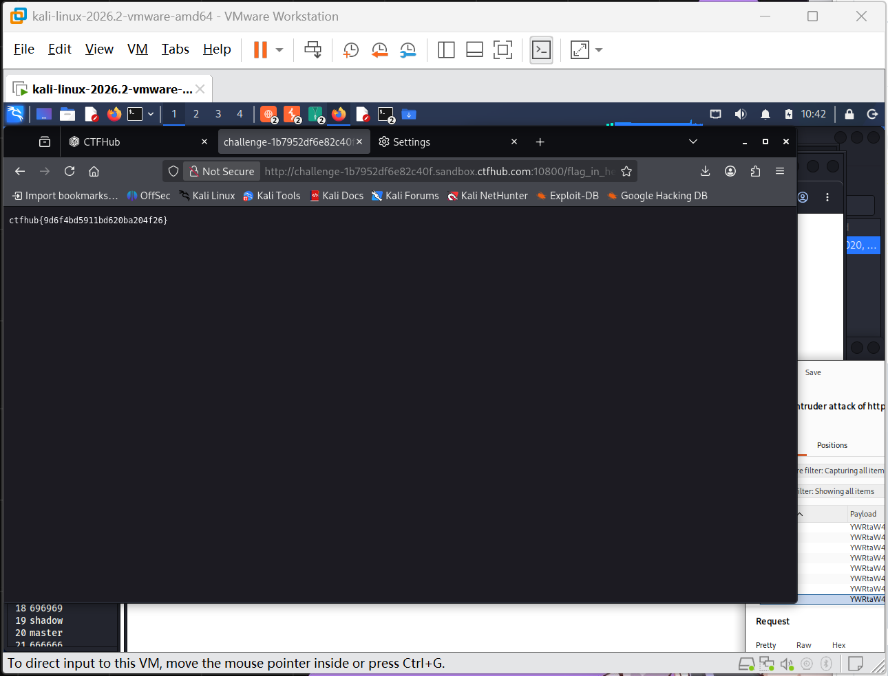

# WP：目录遍历

> **CTFHub 路径**：技能树 → Web → 信息泄露 → 目录遍历
> **任务**：按题目页面提示找到 flag。
> **提示**：注意页面给出的路径和 URL；目录列表本身就是一种信息泄露。只在题目环境内点击和访问，不要使用扫描器扫描其他地址。
> **截图要求**：能看到题目环境地址（或题目名称）、你访问的目录/路径，以及最终的 flag。

---

## 题目信息

| 项目 | 内容 |
| --- | --- |
| 环境地址 | http://challenge-1b7952df6e82c40f.sandbox.ctfhub.com:10800 |
| Flag | ctfhub{9d6f4bd5911bd620ba204f26} |

## 解题过程

我先在 Kali 的浏览器里打开环境地址，页面提示 flag 藏在一个子目录里，并给了一个 `flag_in_h...` 开头的目录链接。点进去之后发现这并不是一个正常的网页，而是一个目录列表（Directory Listing），页面底部能看到一排目录条目（如 696969、shadow、master、666666 等），就像打开了服务器的文件管理器。我逐层点进这些目录，每个子目录里又是一个目录列表，最后在其中一个子目录里看到了 flag 文件，点击打开后页面上直接显示出 flag，提交成功。整个过程没有用到扫描器，全是顺着目录列表一层层点进去的。

## 关键请求/响应

```http
GET /flag_in_h.../... HTTP/1.1
Host: challenge-1b7952df6e82c40f.sandbox.ctfhub.com:10800

HTTP/1.1 200 OK
Content-Type: text/html

（flag 文件内容）
ctfhub{9d6f4bd5911bd620ba204f26}
```

本题不需要修改请求，访问的 URL 路径本身就是关键：每点开一层目录，就是一次对更深层路径的 GET 请求。

## 原理与复盘

这道题对应 HTTP 报文的 URL 路径和响应体：服务器开启了目录列表（autoindex）功能，会把目录下的文件和子目录直接列在响应体里返回给浏览器。攻击者不需要任何工具，只要顺着 URL 路径一层层点下去，就能像浏览本地文件夹一样找到备份、源码、配置甚至 flag 等敏感文件。复盘时我意识到，目录列表往往是因为 Web 服务器配置里没有关掉索引功能，上线前应该显式禁用并对敏感目录做访问控制。

---

## 截图



> 可以在这份 WP 中另加过程截图；检查时只看指定图片，额外图片不检查。
