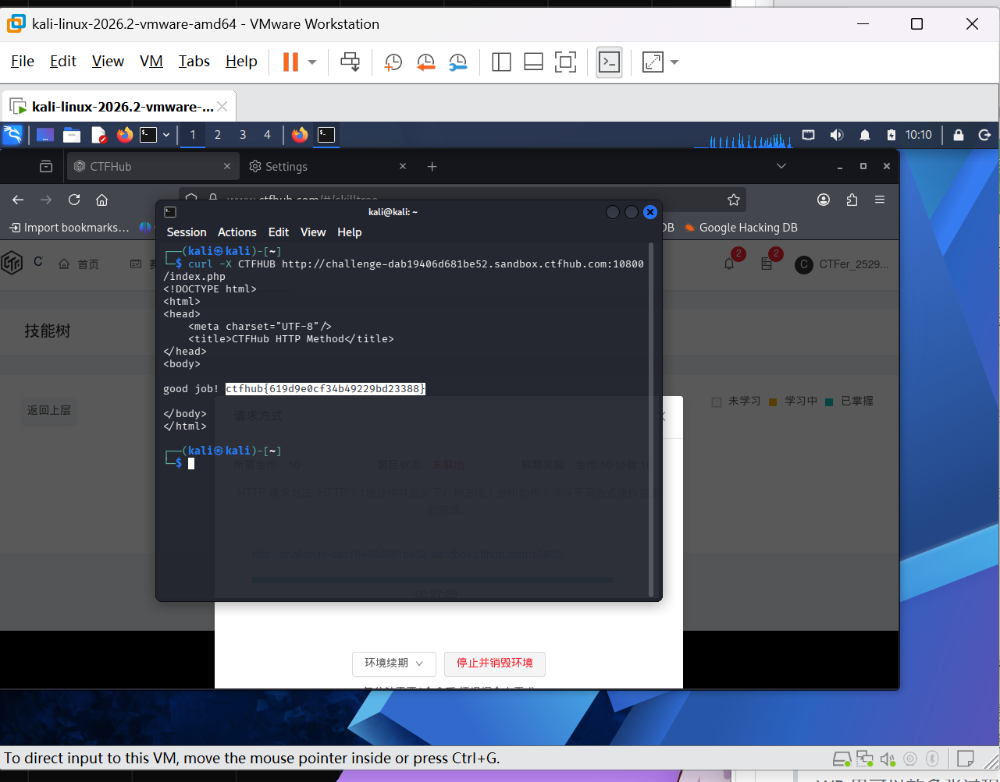

# WP：请求方式

> **CTFHub 路径**：技能树 → Web → Web 前置技能 → HTTP 协议 → 请求方式
> **任务**：按题目要求使用指定的 HTTP 方法访问目标，拿到 flag。
> **提示**：浏览器地址栏默认发送 GET 请求。用 Burp Repeater 修改请求行中的方法，或者用 `curl -X` 复现。
> **截图要求**：优先使用 Burp Repeater，截图中要能看到修改后的请求行（方法 + 路径）和响应中的 flag；如果 Burp 无法启动，可以用 `curl -X` 的方法修改截图代替，并在 WP 中说明原因。只有浏览器普通 GET 访问不算完成。

---

## 题目信息

| 项目 | 内容 |
| --- | --- |
| 环境地址 | http://challenge-dab19406d681be52.sandbox.ctfhub.com:10800/index.php |
| Flag | ctfhub{619d9e0cf34b49229bd23388} |

## 解题过程

先用浏览器普通 GET 访问 index.php，页面提示 “HTTP Method is CTFHUB”，意思是要求用名为 `CTFHUB` 的自定义方法来请求这个页面。浏览器地址栏只能发 GET，于是我回到 Kali 终端，用 curl 的 `-X` 选项直接把请求方法改成 CTFHUB：`curl -X CTFHUB http://challenge-dab19406d681be52.sandbox.ctfhub.com:10800/index.php`。命令回显的响应体里立刻出现了 “good job! ctfhub{619d9e0cf34b49229bd23388}”，把 flag 提交后平台确认正确。

## 关键请求/响应

```http
CTFHUB /index.php HTTP/1.1
Host: challenge-dab19406d681be52.sandbox.ctfhub.com:10800

（curl -X CTFHUB 的响应体）
good job! ctfhub{619d9e0cf34b49229bd23388}
```

说明：Burp 当时主要用在了 302 和基础认证两题上，这题我直接用 `curl -X` 修改请求方法完成，截图里可以看到完整命令和响应中的 flag。

## 原理与复盘

请求行由“方法 + 路径 + HTTP 版本”三部分组成，方法就写在请求行的最开头。方法名本质上只是一个字符串，虽然常见的只有 GET、POST、PUT 等，但服务器端代码完全可以接收并处理任意自定义方法，浏览器的地址栏只会发 GET，并不代表服务器只认 GET。这道题让我明白：判断服务器接受什么方法要看服务端代码和响应，而不是看浏览器能发什么。

---

## 截图



> 可以在这份 WP 中另加过程截图；检查时只看指定图片，额外图片不检查。
