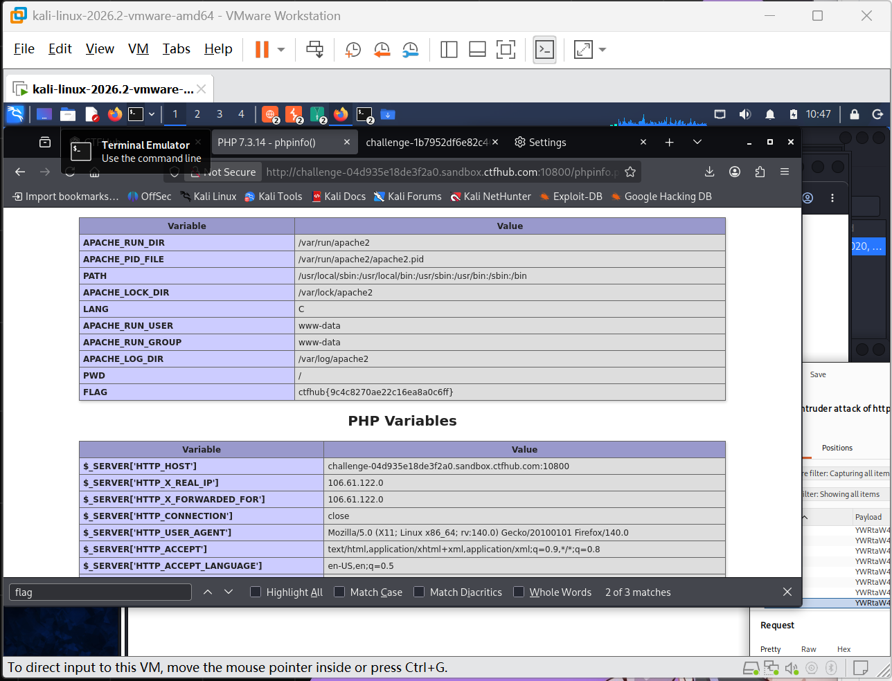

# WP：PHPINFO

> **CTFHub 路径**：技能树 → Web → 信息泄露 → PHPINFO
> **任务**：在 phpinfo 页面中找到 flag，并观察它泄露了哪些信息。
> **提示**：phpinfo 会输出大量 PHP 和服务器配置。用浏览器的查找功能搜索关键字，同时留意页面暴露的路径、版本、环境变量等信息。
> **截图要求**：能看到 phpinfo 页面、你搜索/定位到的 flag，以及至少一处敏感信息。

---

## 题目信息

| 项目 | 内容 |
| --- | --- |
| 环境地址 | http://challenge-04d935e18de3f2a0.sandbox.ctfhub.com:10800/phpinfo.php |
| Flag | ctfhub{9c4c8270ae22c16ea8a0c6ff} |

## 解题过程

打开环境地址后直接就是一整个 phpinfo 页面，内容非常长，全是 PHP 和服务器的配置表格。我先按提示用页面的查找功能（Ctrl+F）搜索关键字 `flag`，滚动定位到 Environment 部分，发现环境变量里就有一个名为 `FLAG` 的变量，它的值就是 flag：`ctfhub{9c4c8270ae22c16ea8a0c6ff}`。提交后平台确认正确。除了 flag，我还注意到页面暴露了不少敏感信息：PHP 版本是 7.3.14，Apache 的运行目录、日志目录（`/var/log/apache2`）、PID 文件路径都写了出来，`$_SERVER` 里还能看到 `HTTP_X_FORWARDED_FOR`（我的真实 IP 106.61.122.0）和 `HTTP_HOST` 等字段。

## 关键请求/响应

```http
GET /phpinfo.php HTTP/1.1
Host: challenge-04d935e18de3f2a0.sandbox.ctfhub.com:10800

HTTP/1.1 200 OK
Content-Type: text/html; charset=UTF-8

（Environment 表格片段）
Variable    Value
FLAG        ctfhub{9c4c8270ae22c16ea8a0c6ff}
PWD         /
```

## 原理与复盘

这道题对应 HTTP 报文的响应体：`phpinfo.php` 没有删除，任何访问者请求它都会得到完整的 PHP 运行环境信息。phpinfo 会暴露 PHP 版本、扩展、服务器路径、环境变量、请求头等，攻击者可以用版本号查找已知漏洞（比如 PHP 7.3.14 对应的 CVE），用路径辅助目录猜测，甚至像本题这样直接从环境变量里拿到敏感值。复盘结论：生产环境必须删除 phpinfo 页面，`disable_functions` 里也应禁用 `phpinfo()`。

---

## 截图



> 可以在这份 WP 中另加过程截图；检查时只看指定图片，额外图片不检查。
