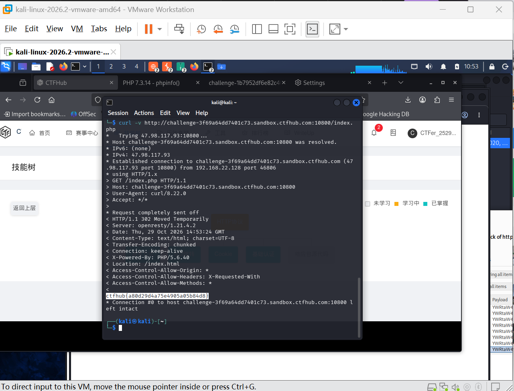
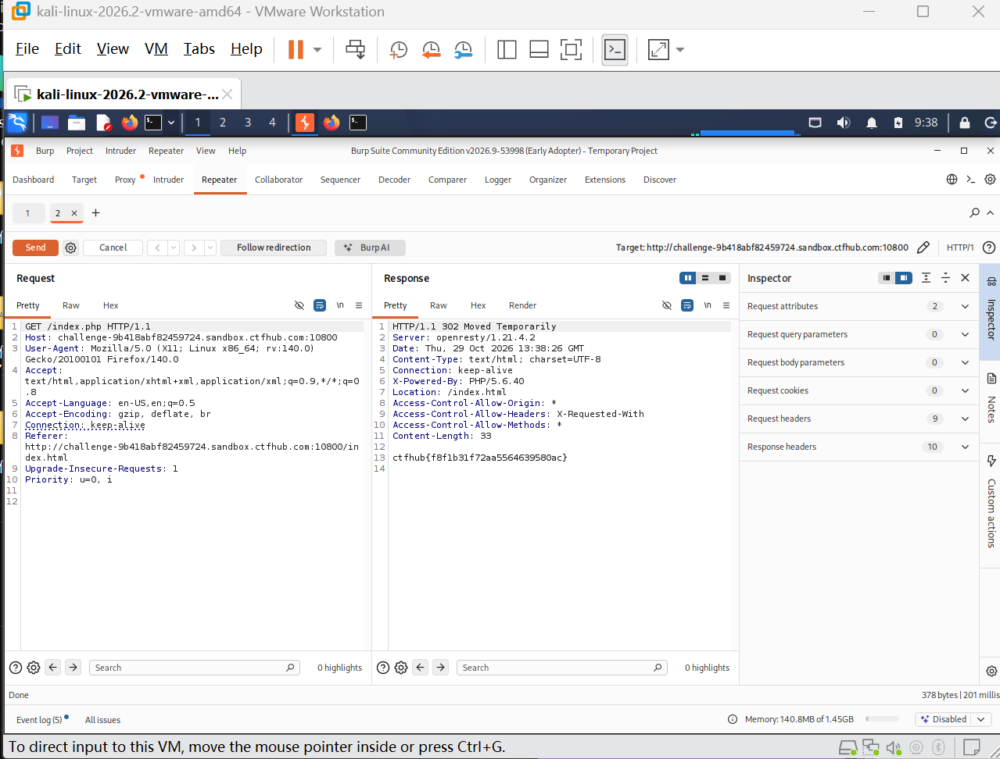

# WP：302 跳转

> **CTFHub 路径**：技能树 → Web → Web 前置技能 → HTTP 协议 → 302 跳转
> **任务**：观察 302 重定向，按题目提示找到 flag。
> **提示**：浏览器通常会自动跟随 302，所以你可能只看到最终页面。打开 DevTools 的 Network 面板（勾选 Preserve log）或 Burp，查看原始响应中的 `302` 状态码和 `Location` 响应头。
> **截图要求**：能看到 302 状态码和/或 `Location` 响应头，以及最终的 flag。只截最终页面、没有 302 证据的截图不合格。

---

## 题目信息

| 项目 | 内容 |
| --- | --- |
| 环境地址 | http://challenge-3f69a64dd7401c73.sandbox.ctfhub.com:10800/index.php |
| Flag | ctfhub{ab80d294a2a5e14950a05b84d8} |

## 解题过程

我先用 curl 加 `-v` 参数访问 `/index.php`，这样终端会把完整的请求和响应都打印出来。输出里能看到服务器返回的并不是 200，而是 `HTTP/1.1 302 Moved Temporarily`，并且响应头里有 `Location: /index.html`，也就是说浏览器平时访问这个页面时会被自动带到 index.html。更关键的是，302 响应自己是有响应体的，flag 就直接写在 302 的响应体末尾：`ctfhub{ab80d294a2a5e14950a05b84d8}`。我还在环境过期前用 Burp Repeater 复现过一次同样的请求，同样能看到 302 状态行、Location 头和响应体里的 flag（见下方附加截图，那次实例的 flag 值不同）。

## 关键请求/响应

```http
GET /index.php HTTP/1.1
Host: challenge-3f69a64dd7401c73.sandbox.ctfhub.com:10800
User-Agent: curl/8.22.0
Accept: */*

HTTP/1.1 302 Moved Temporarily
Server: openresty/1.21.4.2
Location: /index.html
X-Powered-By: PHP/5.6.40

ctfhub{ab80d294a2a5e14950a05b84d8}
```

## 原理与复盘

这道题对应 HTTP 报文的状态行和响应头：`302` 表示临时重定向，浏览器收到后会自动向 `Location` 头指出的地址再发一次请求，所以界面上只看得到最终的 index.html，第一个 302 响应被浏览器“藏”了起来。而 200 是正常返回内容、不再跳转。flag 就写在 302 响应自己的响应体里，只要用 curl 或 Burp 不跟随跳转地看原始响应，就能拿到。复盘体会：浏览器为了体验帮我们做了很多自动处理，做 Web 安全时必须能绕开这些自动化，看到报文本身。

---

## 截图



附加过程截图（Burp Repeater 复现，环境过期前的实例，flag 值不同）：



> 可以在这份 WP 中另加过程截图；检查时只看指定图片，额外图片不检查。
