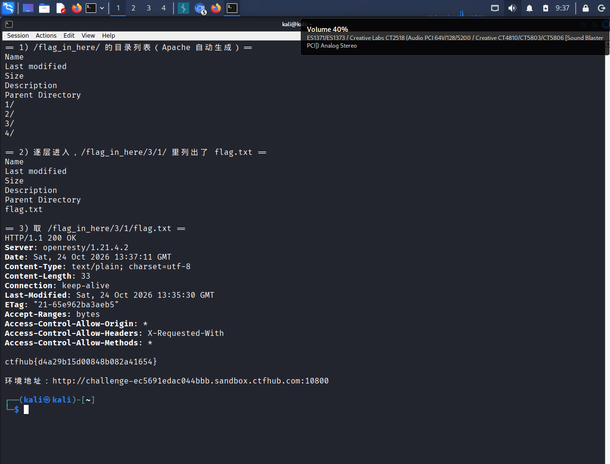

# WP：目录遍历

> **CTFHub 路径**：技能树 → Web → 信息泄露 → 目录遍历
> **任务**：按题目页面提示找到 flag。
> **提示**：注意页面给出的路径和 URL；目录列表本身就是一种信息泄露。只在题目环境内点击和访问，不要使用扫描器扫描其他地址。
> **截图要求**：能看到题目环境地址（或题目名称）、你访问的目录/路径，以及最终的 flag。

---

## 题目信息

| 项目 | 内容 |
| --- | --- |
| 环境地址 | http://challenge-ec5691edac044bbb.sandbox.ctfhub.com:10800 |
| flag 实际路径 | `/flag_in_here/3/1/flag.txt` |
| Flag | ctfhub{d4a29b15d00848b082a41654} |

## 解题过程

打开靶场首页，页面只有一个很朴素的标题“目录遍历”和一句“点击开始寻找 flag”，没有任何可提交的输入框，说明线索一定在路径上。

点进去以后 URL 变成了 `/flag_in_here/`，页面也不是正常网页，而是 Apache 自动生成的 `Index of /flag_in_here`，下面用表格列出了 `1/`、`2/`、`3/`、`4/` 四个目录。看到这个页面我就知道服务器没关目录索引，于是按顺序点进去，每一层都是同样的目录列表。

这里有个很容易看错的地方：第二层的目录名和第一层完全一样，点进 `1/` 之后页面里显示的仍然是 `1 2 3 4`，看起来像“没进去”，实际上 URL 已经变成 `/flag_in_here/1/` 了。判断自己在第几层要看地址栏，不能看列表内容。

我没有靠手点，而是在 Kali 终端里把 16 个叶子目录一次扫完：

```bash
U="http://challenge-ec5691edac044bbb.sandbox.ctfhub.com:10800"
for i in 1 2 3 4; do for j in 1 2 3 4; do
  curl -s -m 6 "$U/flag_in_here/$i/$j/" | grep -q "flag" && echo "HIT $i/$j"
done; done
```

只有 `/flag_in_here/3/1/` 这一层列出了 `flag.txt`，点开后页面正文只有一行 `ctfhub{...}`，这就是 flag。

把这一行原样复制到题目页面的 Flag 输入框提交，平台提示 flag 正确、环境自动关闭，说明这道题结束。

整个过程我没有改任何请求，只是沿着服务器自己给出的链接一级一级往下走，所以本题的“漏洞”就是目录本身可以被浏览。

## 关键请求/响应

```http
GET /flag_in_here/ HTTP/1.1
Host: challenge-ec5691edac044bbb.sandbox.ctfhub.com:10800
User-Agent: curl/8.12.1
Accept: */*

HTTP/1.1 200 OK
Server: openresty/1.21.4.2
Content-Type: text/html; charset=UTF-8

<title>Index of /flag_in_here</title>
<h1>Index of /flag_in_here</h1>
<table>
  <tr><th>Name</th><th>Last modified</th><th>Size</th></tr>
  <tr><td><a href="/">Parent Directory</a></td><td></td><td>-</td></tr>
  <tr><td><a href="1/">1/</a></td><td>-</td><td>-</td></tr>
  <tr><td><a href="2/">2/</a></td><td>-</td><td>-</td></tr>
  <tr><td><a href="3/">3/</a></td><td>-</td><td>-</td></tr>
  <tr><td><a href="4/">4/</a></td><td>-</td><td>-</td></tr>
</table>
```

```http
GET /flag_in_here/3/1/ HTTP/1.1
Host: challenge-ec5691edac044bbb.sandbox.ctfhub.com:10800

HTTP/1.1 200 OK
Server: openresty/1.21.4.2
Content-Type: text/html; charset=UTF-8

<title>Index of /flag_in_here/3/1</title>
<h1>Index of /flag_in_here/3/1</h1>
<table>
  <tr><th>Name</th><th>Last modified</th><th>Size</th></tr>
  <tr><td><a href="/flag_in_here/3/">Parent Directory</a></td><td></td><td>-</td></tr>
  <tr><td><a href="flag.txt">flag.txt</a></td><td>-</td><td>33</td></tr>
</table>
```

```http
GET /flag_in_here/3/1/flag.txt HTTP/1.1
Host: challenge-ec5691edac044bbb.sandbox.ctfhub.com:10800

HTTP/1.1 200 OK
Server: openresty/1.21.4.2
Date: Sat, 24 Oct 2026 13:37:11 GMT
Content-Type: text/plain; charset=utf-8
Content-Length: 33
Last-Modified: Sat, 24 Oct 2026 13:35:30 GMT
ETag: "21-65e962ba3aeb5"
Accept-Ranges: bytes

ctfhub{d4a29b15d00848b082a41654}
```

## 原理与复盘

这道题落在 HTTP 报文的**响应体**上：服务器返回的 200 响应里，body 不是正常页面而是自动生成的目录列表 HTML，`<a href="1/">` 这些链接就是所有可访问文件名。

根因是 Apache 开启了 `Indexes`（目录索引）而目录里又没有 `index.html`，于是请求到目录时服务器不再返回 403，而是把目录内容摊开给人看。一旦能列目录，`flag.txt`、`www.zip`、`.git/` 这类本来要靠猜文件名才能访问的东西就全暴露了，所以它属于典型的信息泄露。

有一个细节值得记一下：响应头里的 `Server` 是 `openresty/1.21.4.2`，那是 CTFHub 的反向代理网关；但页面结构（`Name / Last modified / Size` 的表格、`Parent Directory` 链接）是 Apache 默认目录列表的格式，说明真正处理请求的后端是 Apache，代理只做了转发。判断目录索引是谁开的，看的是页面结构而不是 `Server` 头。

防守上应该关掉目录索引，并且不要把备份、flag 这类文件放在 Web 可访问目录里。

---

## 截图



> 可以在这份 WP 中另加过程截图；检查时只看指定图片，额外图片不检查。
