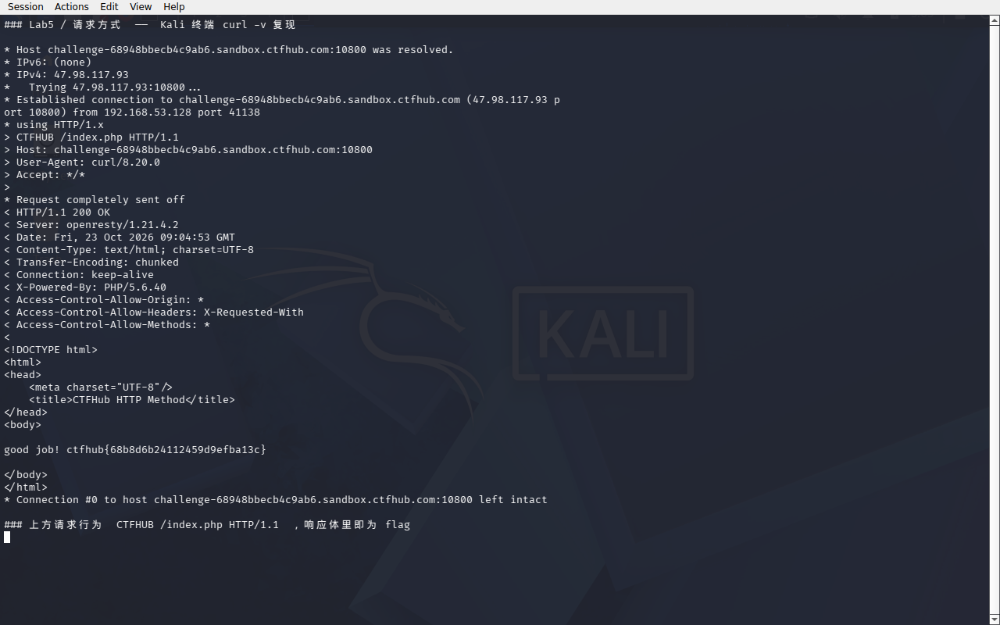

# WP：请求方式

> **CTFHub 路径**：技能树 → Web → Web 前置技能 → HTTP 协议 → 请求方式
> **任务**：按题目要求使用指定的 HTTP 方法访问目标，拿到 flag。
> **提示**：浏览器地址栏默认发送 GET 请求。用 Burp Repeater 修改请求行中的方法，或者用 `curl -X` 复现。
> **截图要求**：优先使用 Burp Repeater，截图中要能看到修改后的请求行（方法 + 路径）和响应中的 flag；如果 Burp 无法启动，可以用 `curl -X` 的方法修改截图代替，并在 WP 中说明原因。只有浏览器普通 GET 访问不算完成。

---

## 题目信息

| 项目 | 内容 |
| --- | --- |
| 环境地址 | http://challenge-68948bbecb4c9ab6.sandbox.ctfhub.com:10800 |
| Flag | ctfhub{68b8d6b24112459d9efba13c} |

## 解题过程

在 Kali 里打开靶场地址，根路径 `/` 直接返回 `302 Moved Temporarily` 并跳到 `Location: index.php`，所以真正要打的页面是 `index.php`。

`index.php` 用 GET 打开后，页面只有三行提示：`HTTP Method is GET`、`Use CTF**B Method, I will give you flag.`，还有一句 `Hint: If you got "HTTP Method Not Allowed" Error, you should request index.php.`。结合平台名就知道，`CTF**B` 指的是 `CTFHUB`，题目要我换掉默认的 GET，用这个方法请求 `index.php`。

浏览器地址栏只能发 GET，改不了方法，所以我直接在 Kali 终端用 curl 发：`curl -v -X CTFHUB http://challenge-68948bbecb4c9ab6.sandbox.ctfhub.com:10800/index.php`。`-v` 会把发出去的请求行、请求头和服务器的响应都打出来，从输出里能清楚看到请求行变成了 `CTFHUB /index.php HTTP/1.1`，响应体里是 `good job! ctfhub{68b8d6b24112459d9efba13c}`。截图就是这一屏 Kali 终端的完整报文（本题用 curl 的 `-X` 留证据，Burp Repeater 的操作完全等价：抓到 GET 之后只把请求行第一个单词改成 `CTFHUB` 再 Send）。

中间试了两个错误的写法，正好印证了提示：把方法 `CTFHUB` 用在根路径 `/` 上，返回的是 `405 Not Allowed`（openresty 直接拒了，根本没到 PHP）；把方法名写成小写 `ctfhub` 再请求 `index.php`，返回 `400 Bad Request`。所以方法名必须大写，路径必须带 `index.php`。

最后把 flag 提交到题目页面，平台提示正确，环境关闭。

## 关键请求/响应

下面是 Kali 终端 `curl -v` 的原始输出（`>` 是发出去的请求，`<` 是收到的响应头，其余是响应体）：

```http
> CTFHUB /index.php HTTP/1.1
> Host: challenge-68948bbecb4c9ab6.sandbox.ctfhub.com:10800
> User-Agent: curl/8.20.0
> Accept: */*
>
* Request completely sent off
< HTTP/1.1 200 OK
< Server: openresty/1.21.4.2
< Date: Fri, 23 Oct 2026 09:04:53 GMT
< Content-Type: text/html; charset=UTF-8
< Transfer-Encoding: chunked
< Connection: keep-alive
< X-Powered-By: PHP/5.6.40
< Access-Control-Allow-Origin: *
< Access-Control-Allow-Headers: X-Requested-With
< Access-Control-Allow-Methods: *
<
<!DOCTYPE html>
<html>
<head>
    <meta charset="UTF-8"/>
    <title>CTFHub HTTP Method</title>
</head>
<body>

good job! ctfhub{68b8d6b24112459d9efba13c}

</body>
</html>
```

```http
# 对照 1：方法对了但路径是根目录，被 openresty 拦掉
CTFHUB / HTTP/1.1
Host: challenge-68948bbecb4c9ab6.sandbox.ctfhub.com:10800

HTTP/1.1 405 Not Allowed
Server: openresty/1.21.4.2

<center><h1>405 Not Allowed</h1></center>
```

```http
# 对照 2：方法名写成小写，直接 400
ctfhub /index.php HTTP/1.1
Host: challenge-68948bbecb4c9ab6.sandbox.ctfhub.com:10800

HTTP/1.1 400 Bad Request
```

## 原理与复盘

这道题改的是**请求行**。请求行的格式是 `方法 SP 请求目标 SP HTTP版本`，方法就是第一个空格前那个单词；`GET` 只是最常用的一种，HTTP/1.1 标准里还有 POST、PUT、DELETE、HEAD、OPTIONS、TRACE、CONNECT，而协议本身允许服务器接受任意自定义的方法名，本题的 `CTFHUB` 就是平台自定义的。

服务端逻辑应该就是判断 `$_SERVER['REQUEST_METHOD'] === 'CTFHUB'` 才输出 flag，否则打印 `HTTP Method is GET` 那句提示，所以只改请求行第一个单词，就走进了完全不同的分支。而 `405 Not Allowed` 出现在前置的 openresty 上，说明请求还没到 PHP 就被反向代理按“路径 + 方法”的规则拒了，这也解释了为什么题目特意提示要带 `index.php`。

复盘：请求方法不是安全边界。只靠“这个接口必须用 POST”“只允许 GET”来防人是没意义的，因为方法本身可以随便换、甚至自定义；安全必须落在身份校验和业务逻辑上。

---

## 截图



> 可以在这份 WP 中另加过程截图；检查时只看指定图片，额外图片不检查。
