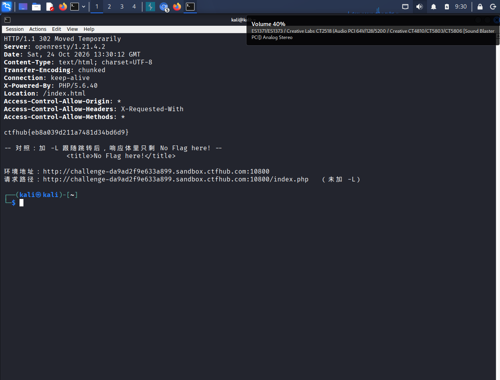

# WP：302 跳转

> **CTFHub 路径**：技能树 → Web → Web 前置技能 → HTTP 协议 → 302 跳转
> **任务**：观察 302 重定向，按题目提示找到 flag。
> **提示**：浏览器通常会自动跟随 302，所以你可能只看到最终页面。打开 DevTools 的 Network 面板（勾选 Preserve log）或 Burp，查看原始响应中的 `302` 状态码和 `Location` 响应头。
> **截图要求**：能看到 302 状态码和/或 `Location` 响应头，以及最终的 flag。只截最终页面、没有 302 证据的截图不合格。

---

## 题目信息

| 项目 | 内容 |
| --- | --- |
| 环境地址 | http://challenge-da9ad2f9e633a899.sandbox.ctfhub.com:10800 |
| Flag | ctfhub{eb8a039d211a7481d34bd6d9} |

## 解题过程

在 Kali 里请求靶场根地址，返回的是静态页 `index.html`：标题和正文都是 `No Flag here!`，下面有一个 `<a href="index.php">Give me Flag</a>` 的链接。所以 flag 一定不在这个页面上，线索只能在这个链接指向的 `index.php` 里。

用浏览器点 `Give me Flag` 时，页面会“闪”一下又回到同一个 `No Flag here!` 页面，什么都看不到。这正是 302 的典型表现：服务器先回了重定向，浏览器读到 `Location` 就自动跳走，把这一次响应的内容丢掉了。

于是我在 Kali 终端里改用 curl 直接请求 `index.php`，并且**故意不加 `-L`**（curl 默认不跟随重定向）。用 `curl -i` 把状态行和响应头一起打出来，就能看到 `HTTP/1.1 302 Moved Temporarily`、`Location: /index.html`，而响应体正文只有一行 `ctfhub{eb8a039d211a7481d34bd6d9}` —— flag 就藏在这次 302 响应的 body 里。

为了确认这就是关键，我又加 `-L` 跑了一遍做对照：curl 跟随跳转后拿到的就是 `index.html` 的 `No Flag here!`，flag 消失。所以结论很明确：能不能拿到，取决于工具跟不跟随重定向。

## 关键请求/响应

```http
GET /index.php HTTP/1.1
Host: challenge-da9ad2f9e633a899.sandbox.ctfhub.com:10800
User-Agent: curl/8.20.0
Accept: */*

HTTP/1.1 302 Moved Temporarily
Server: openresty/1.21.4.2
Date: Sat, 24 Oct 2026 13:30:12 GMT
Content-Type: text/html; charset=UTF-8
Transfer-Encoding: chunked
Connection: keep-alive
X-Powered-By: PHP/5.6.40
Location: /index.html
Access-Control-Allow-Origin: *
Access-Control-Allow-Headers: X-Requested-With
Access-Control-Allow-Methods: *

ctfhub{eb8a039d211a7481d34bd6d9}
```

```http
# 对照：加 -L 跟随跳转后，只剩静态页
GET /index.html HTTP/1.1
Host: challenge-da9ad2f9e633a899.sandbox.ctfhub.com:10800

HTTP/1.1 200 OK
Last-Modified: Mon, 17 Feb 2020 12:19:05 GMT

<html>
  <head><title>No Flag here!</title></head>
  <body>
    <center>
      <h1>No Flag here!</h1>
      <a href="index.php">Give me Flag</a>
    </center>
  </body>
</html>
```

## 原理与复盘

这道题的证据在**状态行**和**响应头**：`HTTP/1.1 302 Moved Temporarily` 是状态行，`Location: /index.html` 告诉客户端“资源暂时在另一个地址”。按规范，302 是临时重定向，浏览器收到后会自动向 Location 再发一次请求，用户最终看到的是新页面的内容。

关键在于：**302 这一次响应本身也有响应体**。浏览器按规范优先处理跳转、把这段 body 丢掉，所以页面上永远看不到 flag；而 curl 不加 `-L`、Burp Repeater、DevTools 勾了 Preserve log 都能读到原始的那一次 302 响应，flag 就在里面。

复盘：只看渲染结果会漏掉中间每一跳的数据。真实场景里，登录跳转、OAuth 回调和 302 前后经常夹带一次性 token 或内部路径，思路是一样的。

---

## 截图



> 可以在这份 WP 中另加过程截图；检查时只看指定图片，额外图片不检查。
