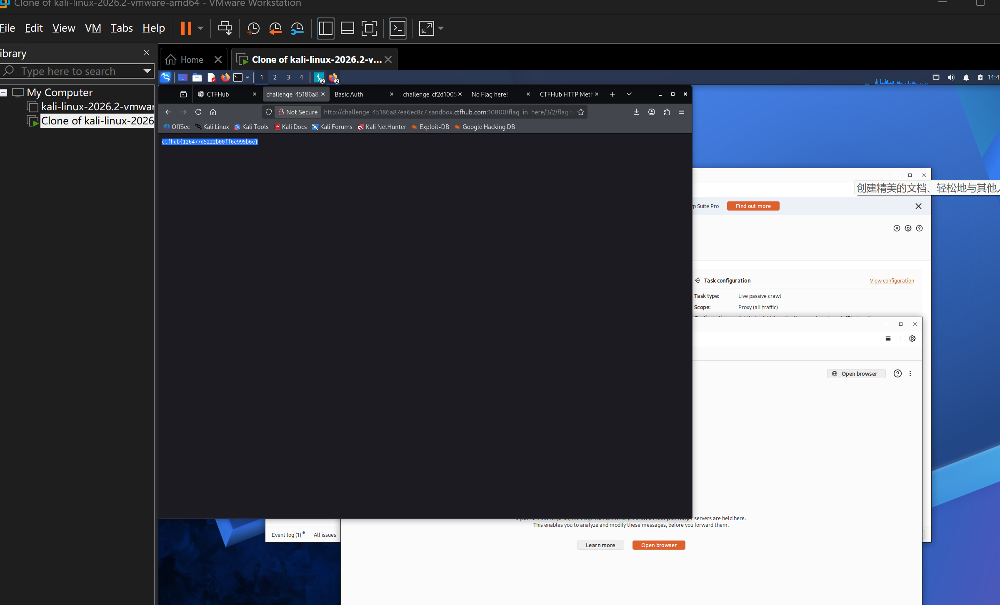

# WP：目录遍历

> **CTFHub 路径**：技能树 → Web → 信息泄露 → 目录遍历
> **任务**：按题目页面提示找到 flag。
> **提示**：注意页面给出的路径和 URL；目录列表本身就是一种信息泄露。只在题目环境内点击和访问，不要使用扫描器扫描其他地址。
> **截图要求**：能看到题目环境地址（或题目名称）、你访问的目录/路径，以及最终的 flag。

---

## 题目信息

| 项目 | 内容 |
| --- | --- |
| 环境地址 | http://challenge-45186a87ea6ec8c7.sandbox.ctfhub.com:10800/ |
| Flag | ctfhub{126477d5222b00ff6e995b6e} |

## 解题过程

开启题目后访问靶场根地址，页面提示 flag 在 `flag_in_here` 目录下。我访问 `/flag_in_here/`，页面直接以目录列表的形式列出了 1、2、3、4 四个子文件夹，这说明服务器没有关掉目录浏览，把目录内容全吐出来了。我按顺序点进去试：目录 1 下面虽然有子目录，但一层层点到底都是空白页，属于干扰路径；目录 3 下面有两个子目录，点进 `2` 之后看到 `flag.txt` 文件。直接点开 `/flag_in_here/3/2/flag.txt`，页面返回一段纯文本 `ctfhub{126477d5222b00ff6e995b6e}`，地址栏里的路径和页面内容对应得上，flag 拿到后回平台提交提示正确。整个过程没有用扫描器，就是手动按目录列表逐层点，这也是这道题想说明的点：只要服务器肯把目录列出来，路径根本不用猜。

## 关键请求/响应

浏览器访问 flag 文件时的请求与响应（Burp/DevTools 中看到的内容一致）：

```http
GET /flag_in_here/3/2/flag.txt HTTP/1.1
Host: challenge-45186a87ea6ec8c7.sandbox.ctfhub.com:10800
User-Agent: Mozilla/5.0 (X11; Linux x86_64) AppleWebKit/537.36 (KHTML, like Gecko) Chrome/146.0.0.0 Safari/537.36
Accept: text/html,application/xhtml+xml,application/xml;q=0.9,*/*;q=0.8

HTTP/1.1 200 OK
Server: openresty/1.21.4.2
Content-Type: text/plain; charset=utf-8

ctfhub{126477d5222b00ff6e995b6e}
```

这次请求没有做任何修改，只是逐层访问目录列表给出的路径。

## 原理与复盘

目录遍历（目录列表）属于信息泄露，位置在**响应体**：请求行里的 URL 指向一个没有默认首页的目录时，服务器不返回 403/404，而是把目录下的文件清单拼成 HTML 返回。一旦目录能列出来，攻击者就不用猜文件名，备份包、源码、配置、`flag.txt` 这类本来不该被访问的文件会被直接列在页面上，所以给目录加默认首页或关闭 `autoindex` 是基本配置。复盘时我也注意到一个细节：目录 1 的空白子目录说明“能列出目录”不等于“里面一定有东西”，真正省时间的是先看目录结构和文件名，而不是急着上扫描器。

---

## 截图



> 可以在这份 WP 中另加过程截图；检查时只看指定图片，额外图片不检查。
