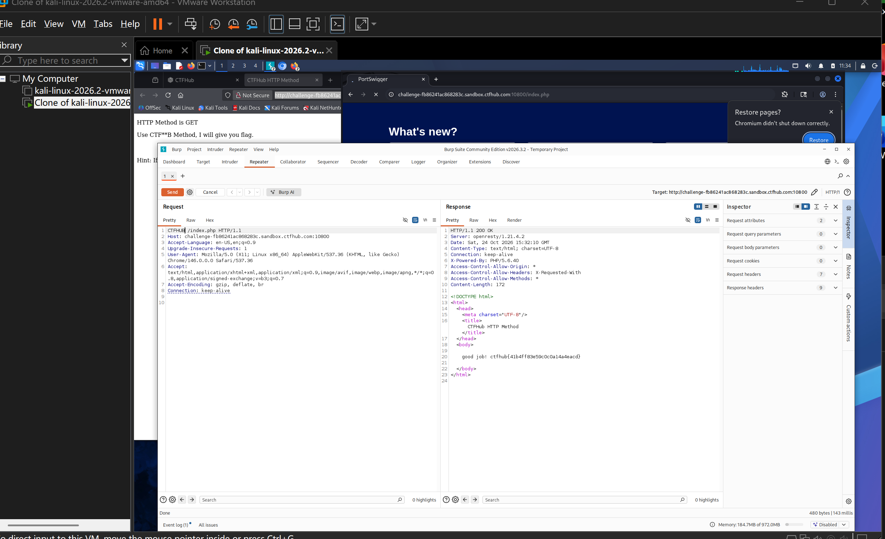

# WP：请求方式

> **CTFHub 路径**：技能树 → Web → Web 前置技能 → HTTP 协议 → 请求方式
> **任务**：按题目要求使用指定的 HTTP 方法访问目标，拿到 flag。
> **提示**：浏览器地址栏默认发送 GET 请求。用 Burp Repeater 修改请求行中的方法，或者用 `curl -X` 复现。
> **截图要求**：优先使用 Burp Repeater，截图中要能看到修改后的请求行（方法 + 路径）和响应中的 flag；如果 Burp 无法启动，可以用 `curl -X` 的方法修改截图代替，并在 WP 中说明原因。只有浏览器普通 GET 访问不算完成。

---

## 题目信息

| 项目 | 内容 |
| --- | --- |
| 环境地址 | http://challenge-fb86241ac868283c.sandbox.ctfhub.com:10800/index.php |
| Flag | ctfhub{41b4ff83e59c0c0a14a4eacd} |

## 解题过程

用浏览器正常打开页面，返回的是 `HTTP Method is GET` 和一行提示 `Use CTFHUB Method, I will give you flag.`，也就是说服务器认的是 `CTFHUB` 这个方法，而浏览器地址栏只会发 GET。我把 Kali 浏览器挂到 Burp 代理（`127.0.0.1:8080`），重新访问一次，在 Proxy → HTTP history 里找到这条 `GET /index.php` 请求，右键 Send to Repeater。在 Repeater 的请求行里把 `GET` 改成 `CTFHUB`，路径和版本保持 `/index.php HTTP/1.1` 不变，点 Send。服务器返回 `HTTP/1.1 200 OK`，响应体里是 `good job! ctfhub{41b4ff83e59c0c0a14a4eacd}`，flag 就在正文里；请求行的路径和 HTTP 版本我从头到尾没动，只换了方法名。

## 关键请求/响应

在 Burp Repeater 里修改后的完整请求与响应：

```http
CTFHUB /index.php HTTP/1.1
Host: challenge-fb86241ac868283c.sandbox.ctfhub.com:10800
Cache-Control: max-age=0
Upgrade-Insecure-Requests: 1
User-Agent: Mozilla/5.0 (X11; Linux x86_64) AppleWebKit/537.36 (KHTML, like Gecko) Chrome/146.0.0.0 Safari/537.36
Accept: text/html,application/xhtml+xml,application/xml;q=0.9,image/avif,image/webp,image/apng,*/*;q=0.8
Referer: http://challenge-fb86241ac868283c.sandbox.ctfhub.com:10800/
Accept-Encoding: gzip, deflate, br
Connection: keep-alive

HTTP/1.1 200 OK
Server: openresty/1.21.4.2
Content-Type: text/html; charset=utf-8
Connection: keep-alive
Access-Control-Allow-Origin: *
Access-Control-Allow-Headers: X-Requested-With
Access-Control-Allow-Methods: *

<html>
<body>
good job! ctfhub{41b4ff83e59c0c0a14a4eacd}
</body>
</html>
```

## 原理与复盘

请求行由“请求方法 + 请求路径 + HTTP 版本”三部分组成，方法就是**请求行最开头**那个词（这里是 `CTFHUB`），服务器靠它决定按什么语义处理这次请求。题目把访问控制做在方法上——只放行 `CTFHUB`——看起来像一道关卡，其实完全依赖客户端的自觉：方法只是报文字符串，任何人用 Burp 或 `curl -X CTFHUB` 都能改。所以真正的方法级限制（禁止 DELETE、限制 PUT 上传等）必须在服务端用配置显式实现，不能靠“浏览器只会发 GET/POST”这种假设。

---

## 截图



> 可以在这份 WP 中另加过程截图；检查时只看指定图片，额外图片不检查。
