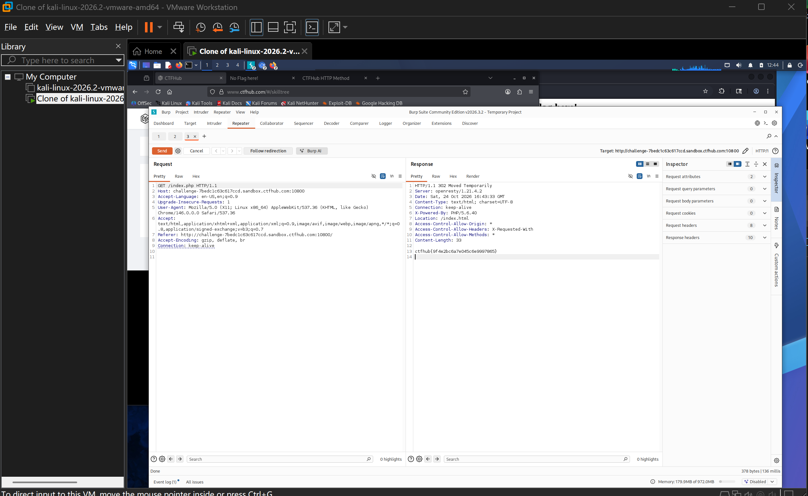

# WP：302 跳转

> **CTFHub 路径**：技能树 → Web → Web 前置技能 → HTTP 协议 → 302 跳转
> **任务**：观察 302 重定向，按题目提示找到 flag。
> **提示**：浏览器通常会自动跟随 302，所以你可能只看到最终页面。打开 DevTools 的 Network 面板（勾选 Preserve log）或 Burp，查看原始响应中的 `302` 状态码和 `Location` 响应头。
> **截图要求**：能看到 302 状态码和/或 `Location` 响应头，以及最终的 flag。只截最终页面、没有 302 证据的截图不合格。

---

## 题目信息

| 项目 | 内容 |
| --- | --- |
| 环境地址 | http://challenge-7bedc1c63c617ccd.sandbox.ctfhub.com:10800/index.php |
| Flag | ctfhub{9f4e2bc6a7e045c6e9997865} |

## 解题过程

第一次用浏览器打开靶场地址，页面一闪就跳到了 `/index.html`，地址栏变成另一条路径，页面上什么有用信息都没有——这就是浏览器自动跟随跳转的结果。为了看中间那一步，我把 Kali 浏览器流量转到 Burp（`127.0.0.1:8080`）后重新访问，在 Proxy → HTTP history 里看到第一条响应是 `HTTP/1.1 302 Moved Temporarily`，响应头里 `Location: /index.html`；把它 Send to Repeater 点一次 Send，响应体里就是 `ctfhub{9f4e2bc6a7e045c6e9997865}`。也就是说 flag 不在跳转后的页面上，而在被 302 “盖住”的那一次响应体里，`Content-Length: 33` 正好是 flag 加一个换行的长度。同样的效果用 `curl -i http://题目地址/index.php` 也能看到，因为 `curl` 默认不跟随跳转。

## 关键请求/响应

```http
GET /index.php HTTP/1.1
Host: challenge-7bedc1c63c617ccd.sandbox.ctfhub.com:10800
User-Agent: Mozilla/5.0 (X11; Linux x86_64) AppleWebKit/537.36 (KHTML, like Gecko) Chrome/146.0.0.0 Safari/537.36
Accept: text/html,application/xhtml+xml,application/xml;q=0.9,image/avif,image/webp,image/apng,*/*;q=0.8

HTTP/1.1 302 Moved Temporarily
Server: openresty/1.21.4.2
Date: Sat, 24 Oct 2026 16:43:33 GMT
Content-Type: text/html; charset=UTF-8
Connection: keep-alive
X-Powered-By: PHP/5.6.40
Location: /index.html
Access-Control-Allow-Origin: *
Access-Control-Allow-Headers: X-Requested-With
Access-Control-Allow-Methods: *
Content-Length: 33

ctfhub{9f4e2bc6a7e045c6e9997865}
```

## 原理与复盘

200 和 302 的区别在**状态行**：200 表示“内容就在这个响应体里”，浏览器直接渲染；302 表示“内容在别处”，浏览器读完响应头里的 `Location` 会悄悄再发一次请求，用户只感知到最终页面，中间那次响应体（flag 就在这里）被直接丢掉了。所以这道题真正的关键不是“跳到哪”，而是“跳之前服务器给了什么”。抓包工具的价值就在这里：它把浏览器藏起来的那一步摊开，302 状态行、`Location` 头、甚至被丢弃的响应体都能看到。复盘时我记住了一条实用判断：页面“看起来什么都没有”时，先怀疑跳转或前端渲染，`curl -i` 不跟随跳转是最快的验证方式。

---

## 截图



> 可以在这份 WP 中另加过程截图；检查时只看指定图片，额外图片不检查。
